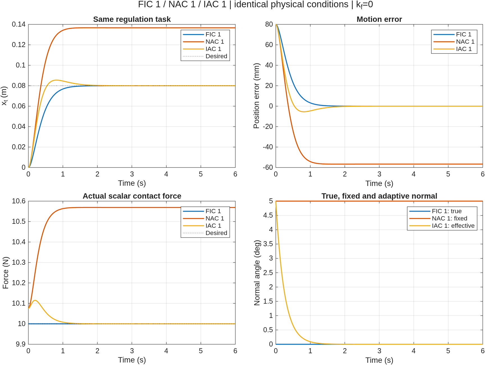
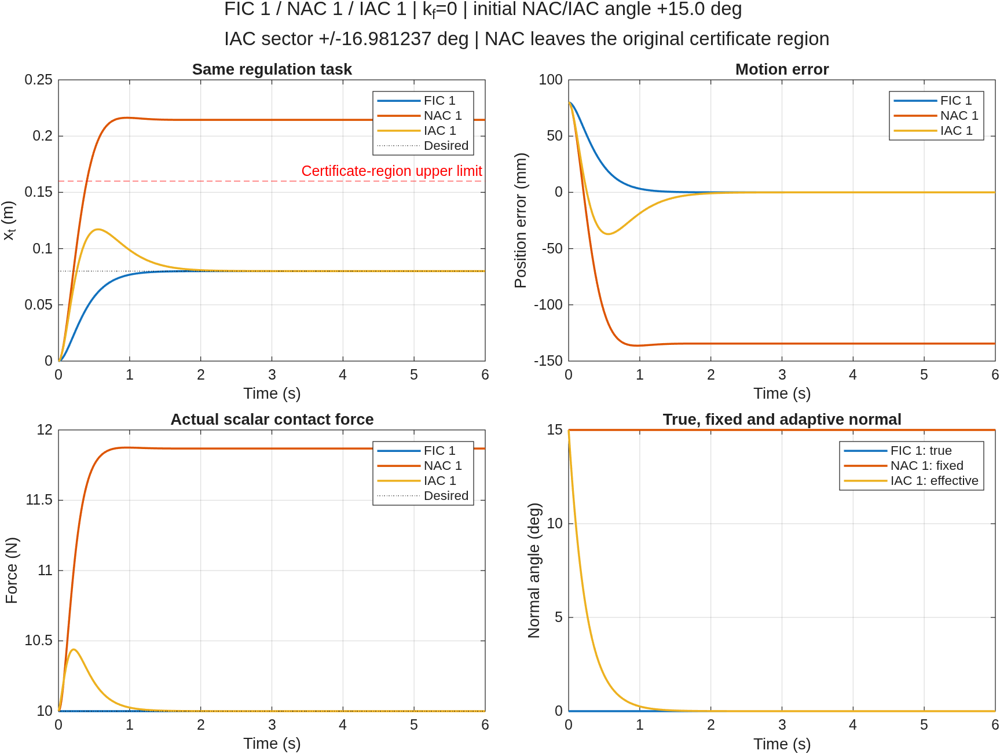

# HMFC：混合运动／力控制 MATLAB 仿真

[English](README.md) | [简体中文](README.zh.md)

本工程使用竖直平面两连杆机器人和无摩擦刚性接触模型，数值验证全信息控制（FIC）、固定不准确法向的非自适应控制（NAC）和 I&I 自适应控制（IAC）。主要比较运动误差、接触力、法向估计和关节力矩，并通过约束动力学和理论关系检查实现。

只需基础 MATLAB，已在 **MATLAB R2026a** 验证。无需 Simulink、Robotics Toolbox 或 Optimization Toolbox。理论来源为同级 Obsidian 仓库中的 `obsidian-vault/04-writing/tcst26/TCST26E3.md`；运行仿真不依赖该笔记仓库。

## 快速开始

将 MATLAB 工作目录切换到本工程根目录，选择所需仿真：

```matlab
% 普通工况：重新运行并比较 FIC 1、NAC 1、IAC 1，初始估计偏差 +5°
comparison = fic1_nac1_iac1_simulation;

% Max angle 工况：接近最大扇区半宽上确界，初始估计偏差 +15°
wide = fic1_nac1_iac1_max_angle_simulation;

% 只运行 NAC 1
nacResults = nac1_simulation;

% 只运行 IAC 1
iacResults = iac1_simulation;

% 运行 FIC 1–4，并检查四种实现的两两等价性
ficResults = fic1234_simulation;
```

默认显示图形并保存结果。三控制器对比入口会分别进行新的 ODE 积分，核对共同工况，再比较各控制器的主调节工况；单控制器入口仍可独立运行。

## 控制器与仿真入口

| 控制器 | 法向信息与控制方式 |
| --- | --- |
| FIC 1–4 | 已知真实法向，采用不同的参考坐标和误差表达；同一任务下验证四种实现等价 |
| NAC 1 | 使用 FIC 1 的控制律，将真实法向替换为固定的初始估计，无角度更新 |
| IAC 1 | 从不准确法向开始，积分内部估计量，通过动量修正构造有效估计并自适应更新 |

| 目的 | MATLAB 入口 | 默认结果目录 |
| --- | --- | --- |
| 单独 FIC 1 | `fic1_simulation` | `results/fic1/` |
| 单独 FIC 2、3、4 | `fic2_simulation`、`fic3_simulation`、`fic4_simulation` | 对应 `results/fic2/`、`fic3/`、`fic4/` |
| FIC 1 与 FIC 2 对比 | `fic12_simulation` | `results/fic12/` |
| FIC 1–3 对比 | `fic123_simulation` | `results/fic123/` |
| FIC 1–4 对比 | `fic1234_simulation` | `results/fic1234/` |
| 单独 NAC 1 | `nac1_simulation` | `results/nac1/` |
| 单独 IAC 1 | `iac1_simulation` | `results/iac1/` |
| 普通 +5° 三控制器对比 | `fic1_nac1_iac1_simulation` | `results/fic1_nac1_iac1/` |
| Max angle / +15° 三控制器对比 | `fic1_nac1_iac1_max_angle_simulation` | `results/fic1_nac1_iac1_max_angle/` |

FIC 1–4 共用 FIC 内部的模型与验证程序。NAC 1、IAC 1 各自包含独立的模型和控制实现；三控制器入口负责运行、工况核对和结果展示。

## 共同模型与工况

| 项目 | 设置 |
| --- | --- |
| 机器人 | 竖直平面 2R，杆长 0.6、0.5 m，质量 2、1.5 kg |
| 质心与转动惯量 | 均匀杆质心与惯量；显式保留重力、科氏项和构型相关惯量 |
| 真实接触面 | 水平直线 `y=0.4 m`，真实法向 `[0;1]` |
| 初始状态 | 接触点 `[0.6;0.4] m`，主工况初始速度为零，接触已建立 |
| 调节参考 | `[0.68;0.4] m`，即沿表面移动 8 cm |
| 运动增益与期望力 | `kp=25`、`kv=10`、`fd=10 N`；三控制器主对比取 `kf=0` |
| IAC 参数 | `gamma=0.4`，扇区中心为 0° |
| 积分与输出 | `ode45`，默认 6 s，输出间隔 0.002 s，`MaxStep=0.01` |
| 原认证运行区 | 切向位移 `x_t` 在 (−0.04,0.16) m 内，肘角 `q2` 在 (70°,115°) 内 |

ODE 使用真实接触面的最小坐标，避免法向约束漂移。接触反力由机器人动力学与刚性约束联立求解，没有直接将反力赋为期望值，也没有引入接触罚弹簧。IAC 积分内部状态 `hat_theta`，有效估计由实际动量修正计算，不直接积分推导后的参数误差方程。

独立入口还执行补充验证：FIC 包含调节、跟踪和 `kf=0,2`；NAC 包含调节的两种力增益；IAC 包含反向偏角、流形不变性及原地调节。三控制器对比图和汇总表只选取各自主调节工况。

## 普通工况与 max angle 工况

| 项目 | 普通工况 | Max angle 工况 |
| --- | --- | --- |
| NAC 固定角度 / IAC 初始有效角度 | +5° | +15° |
| FIC 使用的法向角 | 真实 0° | 真实 0° |
| IAC 扇区半宽 | 6° | 约 16.9812372138° |
| 扇区设置 | 默认闭扇区 | 上确界约 16.9812382138° 减去 `1e-6°` 正裕量 |
| NAC 原认证区域检查 | 越界时报错 | 保留原区域，允许继续物理积分并明确记录越界 |

扇区上确界由当前惯量界自动计算。等号处统一接触力下界为零，因此 max angle 工况从内侧保留正裕量。它改变本组的扇区和初始估计，不改变独立仿真及普通对比的默认设置。

在已验证的 +15° 主工况中，NAC 1 约在 0.400 s 离开原认证区域，随后在同一个可达、非奇异的精确机器人模型上继续积分。这里的越界指离开理论分析区域，不等同于脱离接触或运动发散；越界后的 NAC 轨迹不能直接使用原区域的理论保证。IAC 1 与 FIC 1 仍严格执行原区域检查。

三控制器返回值中应结合查看：

```matlab
wide.summary                      % 误差、接触力、角度和区域状态
wide.allChecksPassed              % 启用的数值一致性检查是否通过
wide.allStayedInOperatingRegion   % 三者是否都留在原认证区域内
wide.nac1.cases(1).firstRegionExitTime
wide.angleAnalysis                % max angle 工况的扇区计算
```

`allChecksPassed=true` 不表示 `allStayedInOperatingRegion=true`。+15° 工况下，NAC 的区域状态为 false，图表和报告会注明。

## 无窗口运行与自定义输出

NAC、IAC 和三控制器入口使用选项结构体：

```matlab
% 保存结果图，但不打开图形窗口
comparison = fic1_nac1_iac1_simulation(struct('visible','off'));
wide = fic1_nac1_iac1_max_angle_simulation(struct('visible','off'));

% 关闭绘图，结果仍保存
comparison = fic1_nac1_iac1_simulation(struct('makePlots',false));

% 指定三控制器结果目录
comparison = fic1_nac1_iac1_simulation( ...
    struct('outputDir',fullfile(pwd,'results','custom_comparison')));

% 单独 IAC 1：只计算和校验，不保存文件、不绘图
iacResults = iac1_simulation(struct('makePlots',false,'saveResults',false));
```

FIC 系列入口使用位置参数 `makePlots, outputDir`：

```matlab
ficResults = fic1234_simulation(false);
ficResults = fic1234_simulation(true,fullfile(pwd,'results','custom_fic'));
```

也可在项目根目录通过终端运行：

```bash
matlab -batch "comparison = fic1_nac1_iac1_simulation(struct('visible','off'));"
```

完整选项及各控制器的公式见下方文档。

## 结果与验证

结果保存在各入口对应的 `results/` 子目录；该目录已被 `.gitignore` 忽略，运行后生成。重复使用相同输出目录会更新同名文件。

三控制器目录主要包含：

- `comparison.png`、`comparison.fig`：位置、运动误差、接触力和法向角对比。
- `summary.csv`、`verification.txt`：三者主工况指标和检查报告。
- `fic1_primary.csv`、`nac1_primary.csv`、`iac1_primary.csv`：统一字段的主工况采样数据。
- `fic1_nac1_iac1_results.mat`：完整结果，包含 `fic1`、`nac1`、`iac1`、`primary` 和 `summary`。
- `fic1/`、`nac1/`、`iac1/`：本次分别运行三个独立仿真的原始输出。
- `initial_angle_analysis.txt`：仅 max angle 工况额外提供，记录上确界、实际半宽和数值裕量。

联合入口为子仿真指定各自的子目录，不覆盖单独入口的默认结果。原 +6° max angle 结果已另存至 `results/fic1_nac1_iac1_max_angle_6deg/`。

仿真内置检查包括关节与笛卡尔动力学残差、接触约束、正反力、运动误差关系、运行区域，以及各自的理论预测：FIC 的解析误差解和实现等价性、NAC 的非线性平衡点、IAC 的有效角度误差方程、指数包络和流形不变性。三控制器入口另核对模型参数、初始状态、参考、增益和输出采样时刻的一致性。

模型采用已知精确动力学、理想执行器、无摩擦刚性接触，以及需要时的精确标量力测量。分析从接触已建立且法向速度为零开始，不包含接触建立、冲击、脱离后的模式切换、测量噪声或力矩饱和。

## 对比结果预览

图像快照保存在 `docs/figures/`，随文档一起保留，不依赖被 Git 忽略的 `results/` 目录。各组完整结果图见对应的详细文档；FIC 多组图可展开查看。原始仿真仍输出到 `results/`。

**普通 +5° 三控制器对比**



**Max angle / +15°：NAC 越出原认证区域，IAC 保持在区域内并收敛**



## 文件与详细文档

| 文件 | 用途 |
| --- | --- |
| `fic_simulation.m` | FIC 1–4 共用的模型、控制律、积分、绘图和验证 |
| `fic_compare_simulation.m` | FIC 两两比较及等价性检查 |
| `fic*_simulation.m` | 各 FIC 入口及 FIC 组合入口 |
| `nac1_simulation.m` | 独立 NAC 1 模型、控制器和验证 |
| `iac1_simulation.m` | 独立 IAC 1 模型、自适应律和验证 |
| `fic1_nac1_iac1_simulation.m` | 三控制器运行、工况核对和对比输出 |
| `fic1_nac1_iac1_max_angle_simulation.m` | 近上确界扇区、+15° 初值的对比配置 |

- [FIC 1–4：公式、工况与等价性验证](docs/FIC.zh.md)
- [NAC 1：固定法向、稳态偏差与选项](docs/NAC1.zh.md)
- [IAC 1：动量修正、自适应律与扇区条件](docs/IAC1.zh.md)
- [FIC 1 / NAC 1 / IAC 1：普通与 max angle 对比](docs/FIC1_NAC1_IAC1.zh.md)
