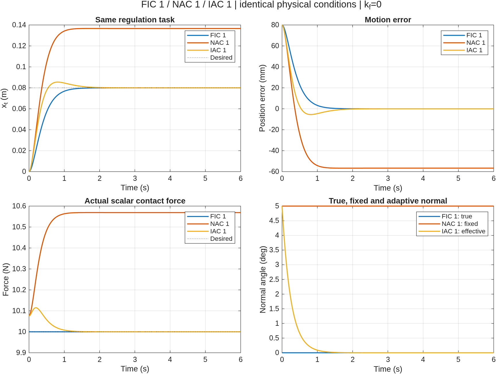
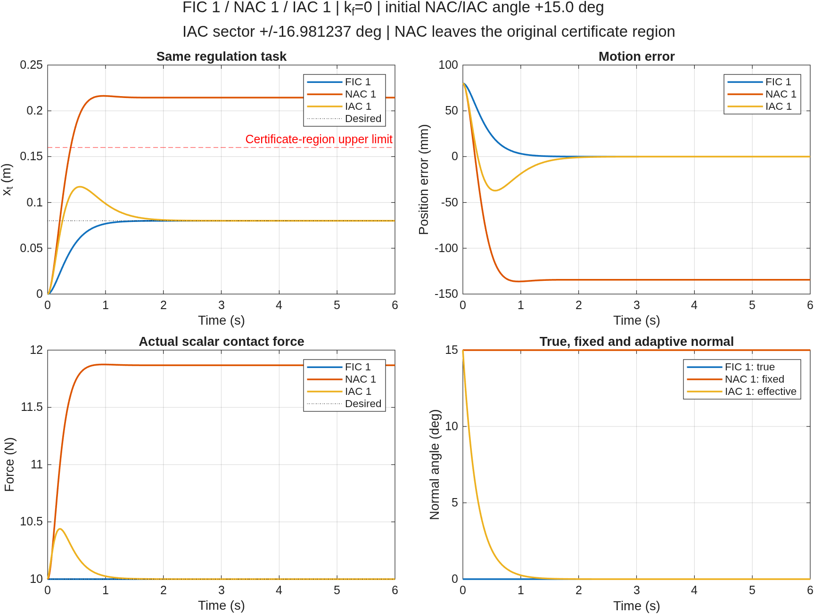
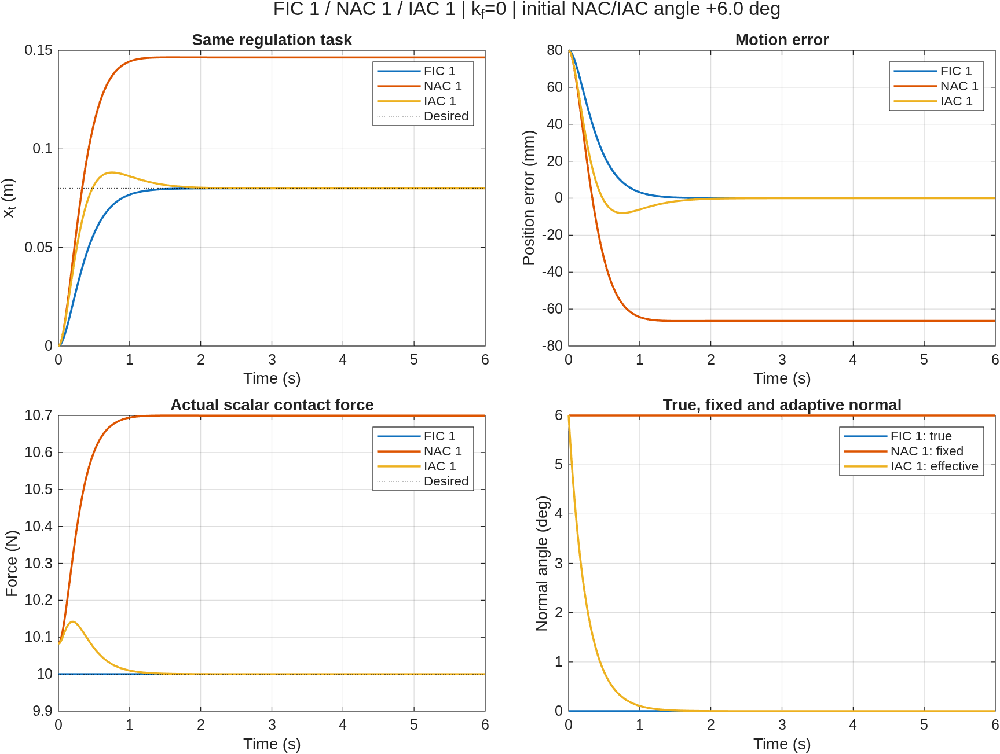

# FIC 1 / NAC 1 / IAC 1 Comparison: Standard and Max Angle Cases

[English](FIC1_NAC1_IAC1.md) | [简体中文](FIC1_NAC1_IAC1.zh.md)

This document covers the standard +5° case and the max angle +15° case. Their entry points and output directories remain separate:

| Case | MATLAB entry point | Initial NAC/IAC angle | IAC sector half-width |
| --- | --- | --- | --- |
| Standard | `fic1_nac1_iac1_simulation` | +5° | 6° |
| Max angle | `fic1_nac1_iac1_max_angle_simulation` | +15° | Supremum minus `1e-6°`, approximately 16.981237° |

To run NAC 1 alone, use `nac1_simulation.m`; see [NAC1.md](NAC1.md).

## Running the standard case

```matlab
% Run NAC 1 only:
nacResults = nac1_simulation;

% Rerun all three controllers and generate comparison results:
comparison = fic1_nac1_iac1_simulation;
```

The three-controller runner also supports:

```matlab
comparison = fic1_nac1_iac1_simulation(struct('visible','off'));
comparison = fic1_nac1_iac1_simulation(struct('makePlots',false));
comparison = fic1_nac1_iac1_simulation(struct('outputDir',fullfile(pwd,'my_comparison')));
comparison = fic1_nac1_iac1_simulation(struct('initialAngleDeg',6));
```

`initialAngleDeg` sets both the fixed NAC 1 angle and the initial effective IAC 1 angle; it still defaults to +5°. `sectorHalfWidthDeg` defaults to 6 and accepts a numerical value or `'supremum'`. The latter subtracts a positive `sectorMarginDeg` margin, defaulting to `1e-6°`, from the supremum to obtain the actual half-width. The max angle entry point selects a near-supremum sector and a +15° initial angle, saving its results separately; details follow below.

`allowNacOutsideOperatingRegion` defaults to false. The max angle runner explicitly sets it to true, allowing only NAC to continue on the same physical model outside the original certified region, while reporting `stayedInOperatingRegion=false` and the first outside sample time. IAC and FIC still enforce the original region checks; the region bounds themselves do not change. Read `results.allChecksPassed` together with `results.allStayedInOperatingRegion`: a true value for the former does not imply a true value for the latter.

## What runs and what is compared

The entry point executes the three independent implementations with fresh ODE integrations. It does not load previously saved results. Models and control laws remain in their respective controller files; individual entry points do not depend on this comparison runner.

The comparison selects the same **main regulation case** for all three: horizontal surface, zero initial velocity, 8 cm target displacement, `kp=25`, `kv=10`, `fd=10 N`, `kf=0`, 6 s integration, and 0.002 s output spacing. FIC 1 uses the true normal; NAC 1 holds +5° fixed; IAC 1 starts at +5° and adapts. The runner checks consistency of robot parameters, true geometry, initial states, references, gains, operating regions, output times, and the initial NAC/IAC estimates.

The constituent entry points also execute their existing supplementary checks. However, the three-controller figures and summary table select only their main cases. The three trajectories are not asserted to coincide; the NAC steady bias from its fixed normal error is one of the effects being compared.

## Separate output directories

| Entry point | Default result directory |
| --- | --- |
| `nac1_simulation` | `results/nac1/`, NAC 1 only |
| `fic1_nac1_iac1_simulation` | `results/fic1_nac1_iac1/`, combined execution and comparison |
| `fic1_nac1_iac1_max_angle_simulation` | `results/fic1_nac1_iac1_max_angle/`, +15° max angle comparison |

The three-controller directories contain:

- `comparison.png/.fig`: position, motion error, contact force, and normal-angle comparisons.
- `summary.csv`, `verification.txt`: three rows of main-case metrics and condition checks.
- `fic1_primary.csv`, `nac1_primary.csv`, `iac1_primary.csv`: main-case samples with common fields.
- `fic1_nac1_iac1_results.mat`: the complete return value, including `results.fic1`, `results.nac1`, `results.iac1`, `results.primary`, and `results.summary`.
- `fic1/`, `nac1/`, `iac1/`: raw outputs of the independent simulations from this run.

The runner explicitly assigns these subdirectories to the constituent simulations, preserving the standalone NAC 1, IAC 1, and FIC 1 default output directories. The combined runner displays and exports comparison figures only; it does not open the individual controllers' supplementary-case figures.

## Max angle case: +15° initial error

The entry point is `fic1_nac1_iac1_max_angle_simulation.m`. This case uses the sector half-width supremum obtained from the current inertia bounds with a small positive margin on the admissible side. NAC 1 remains at +15°, IAC 1 adapts from +15°, and FIC 1 uses the true 0° normal.

### Sector and initial angle

The current inertia bounds give `chi_Lambda=1.484657397642`. The source document's sufficient condition for a strictly positive contact-force bound is:

$$
\rho_{\min}=\cos(2\Delta)-\chi_\Lambda\sin(2\Delta)>0,
\qquad
\Delta<\Delta_{\sup}=\frac12\arctan\frac1{\chi_\Lambda}.
$$

The code computes the supremum from the model and inertia bounds actually used by IAC 1, rather than hard-coding the result:

| Item | This case |
| --- | --- |
| Half-width supremum `Delta_sup` | Approximately 16.9812382138°; equality is excluded |
| Interior numerical margin `sectorMarginDeg` | 0.000001° |
| Actual closed-sector half-width `Delta` | Approximately 16.9812372138° |
| Initial NAC/IAC angle error | +15° |

The actual sector is `[-Delta,+Delta]`. Setting the half-width exactly to the supremum would make the uniform positive-force lower bound zero. The implementation therefore uses `Delta=Delta_sup-sectorMarginDeg` to retain `rho_min>0`. Near the supremum, the uniform force lower bound and exponential rate bound are small. These are conservative certificates covering the entire sector; they do not imply a near-zero actual contact force or slow actual convergence.

The robot, horizontal surface, initial position and velocity, 8 cm reference displacement, `kp=25`, `kv=10`, `fd=10 N`, main-case `kf=0`, 6 s duration, and 0.002 s output spacing are unchanged from the standard case. Standalone IAC 1 and the standard +5° comparison still use the default ±6° sector.

### Running the case

```matlab
% Near-supremum sector with +15° initial error:
wide = fic1_nac1_iac1_max_angle_simulation;

% No figure windows:
wide = fic1_nac1_iac1_max_angle_simulation(struct('visible','off'));

% Change the positive interior margin; the actual half-width must exceed 15°:
wide = fic1_nac1_iac1_max_angle_simulation(struct('sectorMarginDeg',0.001));
```

Supported options are `makePlots`, `visible`, `outputDir`, and `sectorMarginDeg`. The earlier +6° case is archived in `results/fic1_nac1_iac1_max_angle_6deg/`.

### Original certified region and NAC 1 exit

The original region remains `x_t` in (−0.04,0.16) m and `q2` in (70°,115°). IAC 1 inertia bounds and the sector supremum are still based on this region. IAC 1 and FIC 1 enforce the original region checks throughout.

A fixed +15° normal increases NAC 1 bias. This certified region is an analysis assumption, not a physical wall. The comparison allows NAC 1 to continue on the same exact, reachable, nonsingular robot model while retaining the original region bounds and checking and recording exits at every sample. It does not widen IAC's certificate region or report an unmet NAC region condition as satisfied.

Region status is available through `results.nac1.cases(k).operatingRegionSatisfied`, `firstRegionExitTime`, the summary table's `stayedInOperatingRegion`, and the top-level `allStayedInOperatingRegion`. `allChecksPassed` reports enabled dynamics, force, equilibrium, and input-consistency checks and should be read alongside the region status. The first exit time is approximated from samples spaced 0.002 s apart.

To reject a NAC region exit, use the general runner with its default `allowNacOutsideOperatingRegion=false`. The max angle runner explicitly sets it to true to show the complete NAC response to the larger error. Reachability, nonsingularity, and positive-force checks on the exact physical model still apply.

### Additional outputs and measured results

The max angle directory contains the comparison figures, summary tables, CSV files, independent controller subdirectories, and complete MAT file listed above. It also includes `initial_angle_analysis.txt` with the sector calculation. `results.angleAnalysis` records the supremum, actual half-width, numerical margin, 15° initial angle, positive-force lower bound, and NAC region status. Figure titles and reports identify the +15° initial angle to distinguish this run from the archived +6° case.

MATLAB measurements: the IAC 1 +15°, −15°, and other supplementary cases passed their checks and stayed in the original region. The main NAC 1 case was first sampled outside at approximately 0.400 s. Continuing the same physical model, its position error at 6 s was −134.431306 mm and contact force was 11.867829 N. At the same time, IAC 1 position error was approximately −1.64e-10 m and contact force approximately 10 N. All dynamics and contact-force consistency checks passed, while NAC's region status was false.

<!-- simulation-figures -->
## Three-controller result figures

### Standard case: +5°

**FIC 1 / NAC 1 / IAC 1 — +5°**



All three remain in the original certified region. NAC 1 retains a steady bias from its fixed normal, while IAC 1 corrects the effective normal and converges.

### Max angle case: +15°

**FIC 1 / NAC 1 / IAC 1 — +15°**



The sector half-width is approximately 16.981237°. NAC 1 leaves the original certified region at about 0.400 s; the red dashed line marks the tangential-displacement upper limit. The subsequent curve continues the same physical model and does not claim the original region guarantee. IAC 1 and FIC 1 remain inside.

<details>
<summary>Show the archived +6° comparison</summary>

**Archived +6° case: original ±6° sector, not the current +15° max angle default**



</details>
