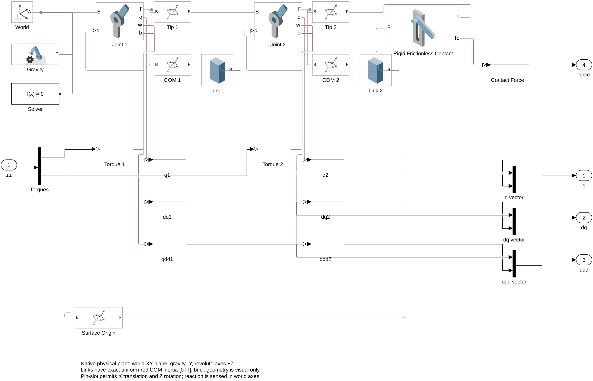
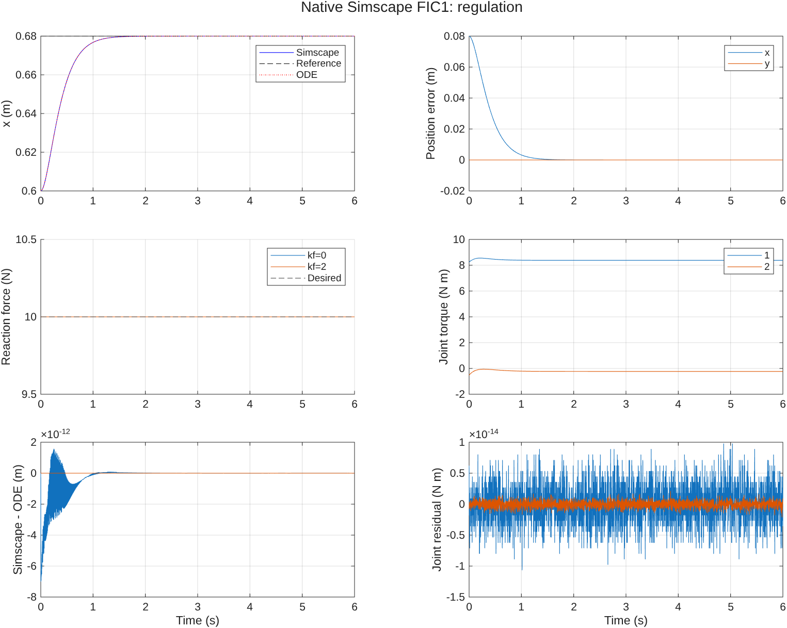
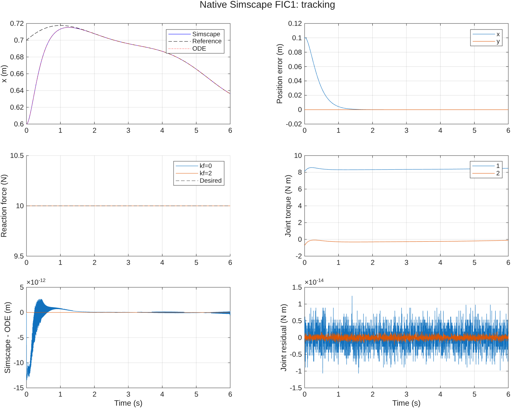

# FIC1: Native Simscape Multibody Simulation

[English](FIC1_SIMSCAPE.md) | [简体中文](FIC1_SIMSCAPE.zh.md)

## Quick start

- [Simscape Multibody model](../hmfc_fic1_simscape.slx)
- [FIC1 simulation entry point](../fic1_simscape_simulation.m)
- [Detailed usage](#running-the-simulation)

Run from the `hmfc` project root:

```matlab
open_system('hmfc_fic1_simscape.slx');
results = fic1_simscape_simulation;
```

All four regulation/tracking cases with `kf=0/2` have passed verification. The maximum position difference from the original ODE simulation is approximately **1.35×10⁻¹¹ m**, and the contact force remains at **10 N** throughout. Results are saved to `results/fic1_simscape/`.

The model uses an ideal rigid constraint for maintained contact and checks that the reaction remains positive. It does not model impacts or contact-mode switching after separation.

## Running the simulation

MATLAB, Simulink, Simscape, and Simscape Multibody are required. The model has been verified in MATLAB R2026a Update 4. The dependencies of the existing ODE simulations are unchanged.

Run from the `hmfc` project root:

```matlab
open_system('hmfc_fic1_simscape.slx');
physical = fic1_simscape_simulation;
physical.summary
physical.allChecksPassed
```

The SLX stores the arm, controller, and model-workspace parameters, so you can click Run directly. The default case is regulation with `kf=0` for 6 s. The Scope displays endpoint position, reference position, normal force, and joint torques.

Automatic opening of the mechanism viewer is disabled by default for headless batch execution. To view the mechanism animation in 3D, run:

```matlab
set_param('hmfc_fic1_simscape','SimMechanicsOpenEditorOnUpdate','on');
sim('hmfc_fic1_simscape');
```

The batch runner executes regulation and tracking with `kf=0,2`, and reruns the original `fic1_simulation` as the reference. By default, it saves plots without opening figure windows:

```matlab
physical = fic1_simscape_simulation(struct('visible','on'));
physical = fic1_simscape_simulation(struct('makePlots',false));
physical = fic1_simscape_simulation(struct('rebuild',true));
```

Outputs are saved to `results/fic1_simscape/`: per-case CSV files, `summary.csv`, `verification.txt`, a complete MAT file, and regulation/tracking plots in PNG and FIG formats. The `ode_reference/` subdirectory contains the ODE reference results generated during the same run.

## Physical arm

The `2R Arm - Simscape Multibody` subsystem in `hmfc_fic1_simscape.slx` is a reusable physical arm. Its input is the pair of joint torques. Its outputs, in order, are joint positions, joint velocities, joint accelerations, and the three-dimensional contact reaction resolved in world coordinates.

| Item | Implementation |
| --- | --- |
| Motion plane | World XY plane; both joint axes point along +Z |
| Gravity | `[0,-9.81,0]` m/s² |
| Link lengths | 0.6 and 0.5 m |
| Masses | 2 and 1.5 kg |
| Centers of mass | 0.3 and 0.25 m from the respective proximal joints |
| Planar moments of inertia about the centers of mass | 0.06 and 0.03125 kg·m² |
| Joints | Revolute Joint blocks with torque inputs; motion is computed by the physical solver |
| Initial configuration | Positive-elbow branch calculated from `[0.6;0.4]` m, with zero initial velocity |
| Contact surface | `y=0.4` m; horizontal, frictionless, and ideally rigid |

Both links use Brick Solid blocks for visualization, with mass, center of mass, and inertia specified explicitly. The three-dimensional inertia of an ideal uniform slender rod about its center of mass is `[0,I,I]`, where $I=ml^2/12$. The displayed brick thickness does not enter the mass or inertia calculation. The inertia in the motion plane therefore matches the original ODE model exactly and is unaffected by the displayed thickness.

Rigid Transform blocks connect each link's proximal joint, center of mass, and tip. The physical arm contains no MATLAB Function block, explicit mass matrix, inverse-kinematics integrator, or prescribed joint motion. Multibody generates and solves the dynamics from the rigid bodies, joints, gravity, and constraints. Initial joint angles are used only as state targets.

## Contact constraint and reaction

A Pin Slot Joint connects the endpoint to a surface frame fixed at `[0.6,0.4,0]`. This joint allows translation along the base frame's X axis and rotation about Z. For the 2R arm already confined to the XY plane, it preserves tangential sliding while constraining the endpoint's normal position and leaving its orientation free.

The contact reaction is read directly from the joint's `Constraint Force` port. The measurement direction is `Base on Follower`, and the resolution frame is `Base`. The second component is therefore the positive upward reaction $f$ exerted by the surface on the arm, consistent with the original simulation's force convention. The tangential reaction should be zero.

This is a **bilateral constraint implementation of the established, maintained-contact branch**. The root-level `Contact Must Stay Positive` assertion requires $f>0$, and the batch verification also checks positive reaction throughout. Under sustained compression, this is equivalent to the original theory's rigid-contact model. It does not implement contact establishment, impacts, or mode transitions after separation. No contact penalty spring or contact damping is used.

References: [MathWorks Pin Slot Joint](https://www.mathworks.com/help/sm/ref/pinslotjoint.html), [Force and Torque Sensing](https://www.mathworks.com/help/sm/ug/force-and-torque-sensing.html).

## FIC1 controller

The controller reads $q,\dot q$ from the physical joint sensors and obtains $p,\dot p$ using the known kinematics. The normal force comes from the physical constraint sensor described above. The control law matches FIC1 in `fic_simulation.m`:
$$
\begin{align}
u_p&=\ddot p_d+k_v(\dot p_d-\dot p)+k_p(p_d-p),\\
u_f&=f_d+k_f(f_d-f),\\
\tau&=C(q,\dot q)\dot q+G(q)+M(q)J(q)^{-1}(u_p-\dot J(q,\dot q)\dot q)-J(q)^Tnu_f.
\end{align}
$$
Here $k_p=25$, $k_v=10$, $f_d=10$ N, and $n=[0;1]$. The implementation uses linear solves rather than explicit matrix inversion.

The regulation reference is `[0.68;0.4]` m. The tracking reference and its analytical derivatives are the same as in the original ODE simulation:
$$
\begin{align}
p_d(t)&=p_0+T\left(0.08+0.045\sin(0.8t)+0.02\cos(1.3t)\right).
\end{align}
$$
The root-level MATLAB Function block embeds the source of `fic1_simscape_controller.m`. Its dynamics calculations are used only for controller compensation. The physical network solves the arm states and contact force; they are not assigned their ideal closed-loop values.

The ideal force sensor output feeds directly into the torque command, creating an algebraic loop. The model uses the `LineSearch` algebraic-loop solver and keeps the algebraic-loop diagnostic enabled. This diagnostic is expected for the current ideal continuous-time feedback structure. No sample delay, Memory block, or filter is added. Even with `kf=0`, tunable parameters and controller ports can retain the structural loop.

## Parameters and rebuilding

The readable source files are:

| File | Purpose |
| --- | --- |
| `hmfc_simscape_parameters.m` | Physical parameters, initial state, and controller gains matching the original simulation |
| `build_hmfc_simscape.m` | Programmatic construction of the physical network, controller, sensors, Scope, and logging |
| `fic1_simscape_controller.m` | FIC1 MATLAB Function source embedded in the model |
| `fic1_simscape_simulation.m` | Four-case batch execution, ODE comparison, checks, and plotting |
| `plot_fic1_simscape_results.m` | Replotting from saved data |
| `hmfc_fic1_simscape.slx` | Generated model, ready to open and simulate |

After editing parameters or controller source, run `build_hmfc_simscape` to update the SLX. The builder refuses to overwrite an open model that has unsaved changes.

You can also select an individual case in the open model's workspace:

```matlab
mdl = 'hmfc_fic1_simscape';
load_system(mdl);
w = get_param(mdl,'ModelWorkspace');
assignin(w,'mode',1);  % 0: regulation; 1: tracking
assignin(w,'kf',2);
out = sim(mdl);
```

The SLX model workspace stores `c`, `mode`, and `kf`. Direct simulation requires no initialization script. The batch verification runner reloads the parameter file and requires it to match the original ODE parameters.

The model uses `ode15s` with relative tolerance `1e-9`, absolute tolerance `1e-10`, and maximum step size 0.005 s. The Simscape local fixed-step solver is disabled. Comparison data are sampled every 0.002 s over 6 s.

## Verification

All four cases check:

- Arm parameters match the original ODE model, and joint states, endpoint position/velocity, torques, and contact force agree with the ODE results generated during the same run.
- $f>0$ throughout; the endpoint remains on the contact surface, with zero normal velocity and zero tangential reaction.
- Physical joint accelerations and measured reactions independently satisfy the original joint dynamics, as checked by the residual:
$$
\begin{align}
r_\tau&=M(q)\ddot q+C(q,\dot q)\dot q+G(q)-\tau-J(q)^Tnf.
\end{align}
$$
- The elbow angle stays within $(70^\circ,115^\circ)$, and the tangential displacement stays within $(-0.04,0.16)$ m.

Across the four verified cases, the maximum endpoint position difference from the ODE reference is at most $1.35\times10^{-11}$ m, the maximum force error is at most $1.78\times10^{-14}$ N, and the maximum joint-dynamics residual is at most $2.14\times10^{-14}$ N·m. The contact force remains approximately 10 N throughout. Detailed errors are saved in `summary.csv` and `verification.txt`. These checks cover the current exact model and the four cases; they do not extend to friction, compliant contact, actuator saturation, or contact switching.

## Model and result previews






