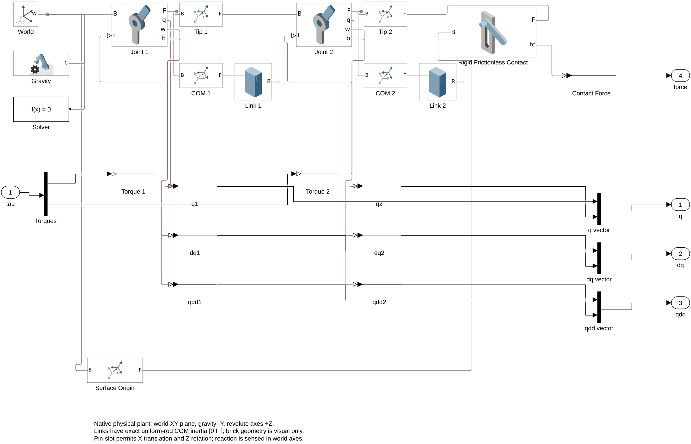
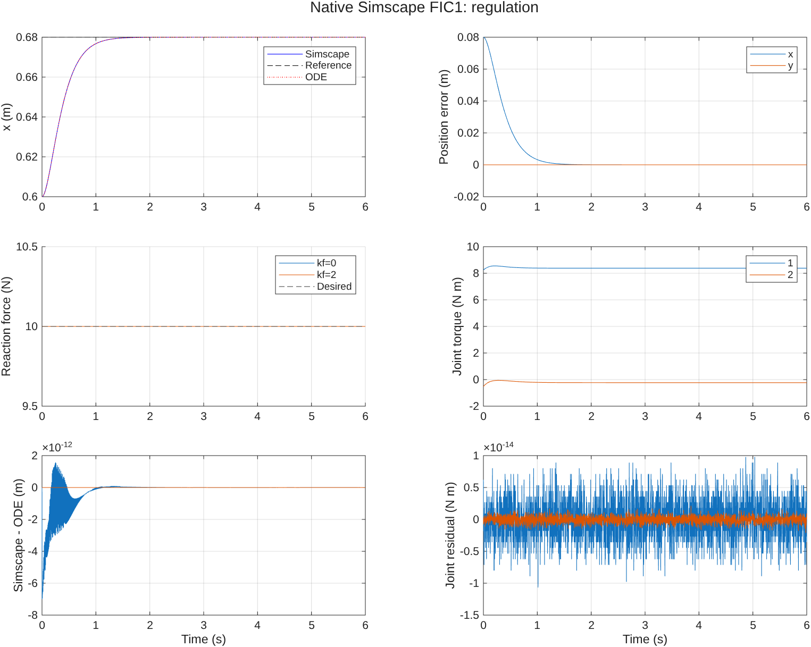
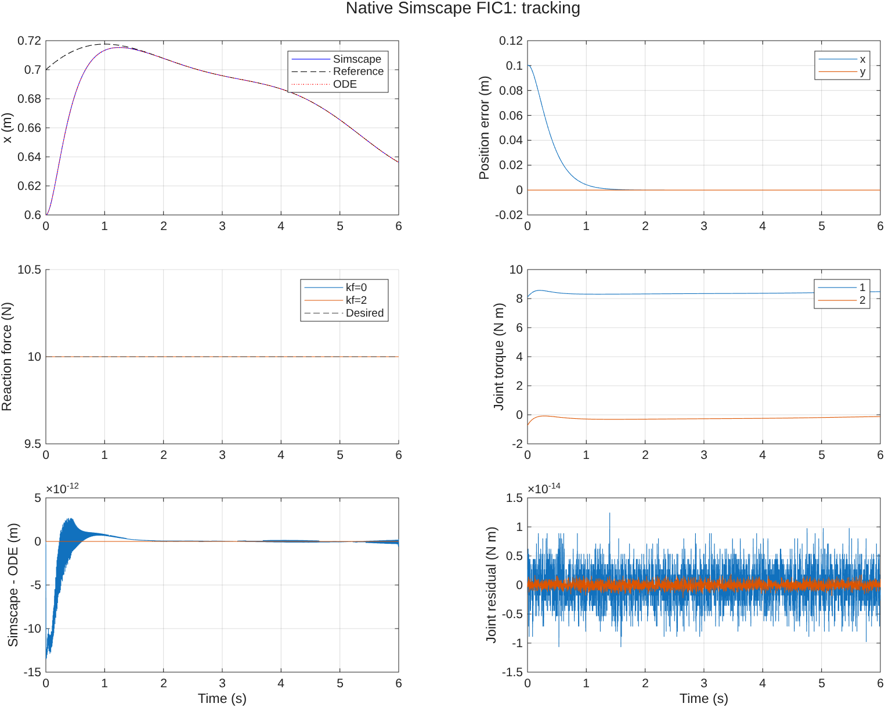

# FIC1 的原生 Simscape Multibody 仿真

[English](FIC1_SIMSCAPE.md) | [简体中文](FIC1_SIMSCAPE.zh.md)

## 快速开始

- [Simscape Multibody 模型](../hmfc_fic1_simscape.slx)
- [FIC1 仿真入口](../fic1_simscape_simulation.m)
- [详细使用说明](#运行方式)

在工程根目录 `hmfc` 中运行：

```matlab
open_system('hmfc_fic1_simscape.slx');
results = fic1_simscape_simulation;
```

调节／跟踪、`kf=0/2` 四种工况已全部通过验证。与原 ODE 的最大位置差约为 **1.35×10⁻¹¹ m**，接触力全程保持 **10 N**。结果保存在 `results/fic1_simscape/`。

模型采用理想刚性持续接触约束，并检查正反力；不包含碰撞和脱离后的接触切换。

## 运行方式

需要 MATLAB、Simulink、Simscape 和 Simscape Multibody。模型已在 MATLAB R2026a Update 4 验证。原有 ODE 仿真的依赖不变。

在 `hmfc` 根目录执行：

```matlab
open_system('hmfc_fic1_simscape.slx');
physical = fic1_simscape_simulation;
physical.summary
physical.allChecksPassed
```

`SLX` 已保存机械臂、控制器和模型工作区参数，可以直接点击 Run。默认工况为调节、`kf=0`、6 s。Scope 显示末端位置、参考位置、法向力和关节力矩。

默认关闭自动弹出的机构查看器，方便无界面批量运行。需要查看三维机构动画时，可执行：

```matlab
set_param('hmfc_fic1_simscape','SimMechanicsOpenEditorOnUpdate','on');
sim('hmfc_fic1_simscape');
```

批量入口运行调节／跟踪以及 `kf=0,2` 四种工况，同时重新运行原 `fic1_simulation` 作为对照。默认保存结果图但不弹出窗口：

```matlab
physical = fic1_simscape_simulation(struct('visible','on'));
physical = fic1_simscape_simulation(struct('makePlots',false));
physical = fic1_simscape_simulation(struct('rebuild',true));
```

输出保存在 `results/fic1_simscape/`，包括各工况 CSV、`summary.csv`、`verification.txt`、完整 MAT，以及调节／跟踪的 PNG 和 FIG。`ode_reference/` 保存本次重新运行的 ODE 对照结果。

## 物理机械臂

`hmfc_fic1_simscape.slx` 中的 `2R Arm - Simscape Multibody` 子系统是可复用的物理机械臂。输入为两个关节力矩，输出依次为关节角、关节角速度、关节角加速度，以及世界坐标中的三维接触反力。

| 项目 | 实现 |
| --- | --- |
| 运动平面 | 世界 XY 平面，两个转轴均沿 +Z |
| 重力 | `[0,-9.81,0]` m/s² |
| 杆长 | 0.6、0.5 m |
| 质量 | 2、1.5 kg |
| 质心 | 距各自近端关节 0.3、0.25 m |
| 平面质心惯量 | 0.06、0.03125 kg·m² |
| 关节 | Revolute Joint，力矩输入，运动由物理求解器计算 |
| 初始构型 | 由 `[0.6;0.4]` m 计算的正肘支路，初始速度为零 |
| 接触面 | `y=0.4` m，水平、无摩擦、理想刚性 |

两根杆使用 Brick Solid 显示外形，同时显式指定质量、质心和惯量。理想均匀细杆的三维质心惯量为 `[0,I,I]`，其中 $I=ml^2/12$；砖块可视化厚度不参与质量与惯量计算。因此运动平面内的惯量与原 ODE 精确一致，不会因显示厚度改变机械臂模型。

Rigid Transform 将每根杆的近端、质心与末端连接。物理机械臂内部没有 MATLAB Function、显式质量矩阵、逆运动学积分器或预设关节运动；动力学由 Multibody 根据刚体、关节、重力和约束生成并求解。初始关节角只作为状态目标。

## 接触约束及反力

末端通过 Pin Slot Joint 连接到固定在 `[0.6,0.4,0]` 的表面坐标系。该关节允许沿基坐标 X 轴平移和绕 Z 轴转动；对于原本处于 XY 平面的 2R 机械臂，这就保留了沿面的滑动并约束末端法向位置，末端姿态保持自由。

接触反力直接从关节的 `Constraint Force` 端口取得，测量方向设置为 `Base on Follower`，分解坐标系设置为 `Base`。因此第二个分量是表面对机械臂的向上正反力 $f$，与原仿真的力符号相同。切向反力应为零。

这是**接触已建立、持续接触分支的双边约束实现**。根层的 `Contact Must Stay Positive` 断言要求 $f>0$，批量验证也检查全程正反力。它与原理论在持续压紧条件下的刚性接触等价；不实现接触建立、冲击或脱离后的模式切换。未采用接触罚弹簧或接触阻尼。

参考：[MathWorks Pin Slot Joint](https://www.mathworks.com/help/sm/ref/pinslotjoint.html)、[关节力与力矩传感](https://www.mathworks.com/help/sm/ug/force-and-torque-sensing.html)。

## FIC1 控制器

控制器从实际关节传感器读取 $q,\dot q$，通过已知运动学得到 $p,\dot p$；法向力来自上述物理约束传感器。控制律与 `fic_simulation.m` 的 FIC1 一致：
$$
\begin{align}
u_p&=\ddot p_d+k_v(\dot p_d-\dot p)+k_p(p_d-p),\\
u_f&=f_d+k_f(f_d-f),\\
\tau&=C(q,\dot q)\dot q+G(q)+M(q)J(q)^{-1}(u_p-\dot J(q,\dot q)\dot q)-J(q)^Tnu_f.
\end{align}
$$
其中 $k_p=25$、$k_v=10$、$f_d=10$ N、$n=[0;1]$。实现使用线性方程求解，避免显式求逆。

调节参考为 `[0.68;0.4]` m；跟踪参考及其解析导数与原 ODE 相同：
$$
\begin{align}
p_d(t)&=p_0+T\left(0.08+0.045\sin(0.8t)+0.02\cos(1.3t)\right).
\end{align}
$$
根层 MATLAB Function 块内嵌 `fic1_simscape_controller.m` 的源代码，代码中的动力学只用于控制补偿。机械臂的状态和接触力由物理网络求解，未赋值为理想闭环解。

理想力传感器的输出直接进入力矩命令，形成代数环。模型使用 `LineSearch` 代数环求解器，保留代数环诊断；看到该诊断是当前连续时间理想反馈结构的正常现象。没有添加采样延迟、Memory 或滤波环节。即使 `kf=0`，可调参数和控制器端口也可能保留该结构上的环。

## 参数与重建

可读源文件如下：

| 文件 | 功能 |
| --- | --- |
| `hmfc_simscape_parameters.m` | 与原仿真一致的物理参数、初始状态和控制增益 |
| `build_hmfc_simscape.m` | 程序化搭建物理网络、控制器、传感器、Scope 和日志 |
| `fic1_simscape_controller.m` | 嵌入模型的 FIC1 MATLAB Function 源码 |
| `fic1_simscape_simulation.m` | 四工况批量运行、ODE 对照、检查及绘图 |
| `plot_fic1_simscape_results.m` | 使用已保存的数据重新绘图 |
| `hmfc_fic1_simscape.slx` | 可直接打开和仿真的已生成模型 |

修改参数或控制器源文件后，执行 `build_hmfc_simscape` 更新 SLX。重建函数不会覆盖当前已打开且存在未保存修改的模型。

也可以在已打开模型的工作区选择单个工况：

```matlab
mdl = 'hmfc_fic1_simscape';
load_system(mdl);
w = get_param(mdl,'ModelWorkspace');
assignin(w,'mode',1);  % 0：调节；1：跟踪
assignin(w,'kf',2);
out = sim(mdl);
```

SLX 的模型工作区内保存 `c`、`mode`、`kf`。直接仿真不要求先执行初始化脚本；批量验证入口会重新使用参数文件，并要求其与原 ODE 参数一致。

模型采用 `ode15s`，相对容差 `1e-9`、绝对容差 `1e-10`、最大步长 0.005 s；不启用 Simscape 局部固定步长求解器。对照数据按 0.002 s 采样，持续 6 s。

## 验证内容

四种工况均检查：

- 机械臂参数与原 ODE 相同，关节、末端位置／速度、力矩及接触力与本次 ODE 结果一致。
- 全程 $f>0$、末端保持在接触面上、法向速度与切向反力为零。
- 使用物理关节加速度和实测反力，独立检查原动力学残差：
$$
\begin{align}
r_\tau&=M(q)\ddot q+C(q,\dot q)\dot q+G(q)-\tau-J(q)^Tnf.
\end{align}
$$
- 肘角处于 $(70^\circ,115^\circ)$，沿面位移处于 $(-0.04,0.16)$ m。

本次四种工况的最大末端位置对照误差不超过 $1.35\times10^{-11}$ m，最大力误差不超过 $1.78\times10^{-14}$ N，最大关节动力学残差不超过 $2.14\times10^{-14}$ N·m；接触力全程约为 10 N。具体误差保存在 `summary.csv` 与 `verification.txt`。通过上述检查只覆盖当前精确模型与四种工况；它不扩展到摩擦、弹性接触、执行器饱和或接触切换。

## 模型与结果预览






