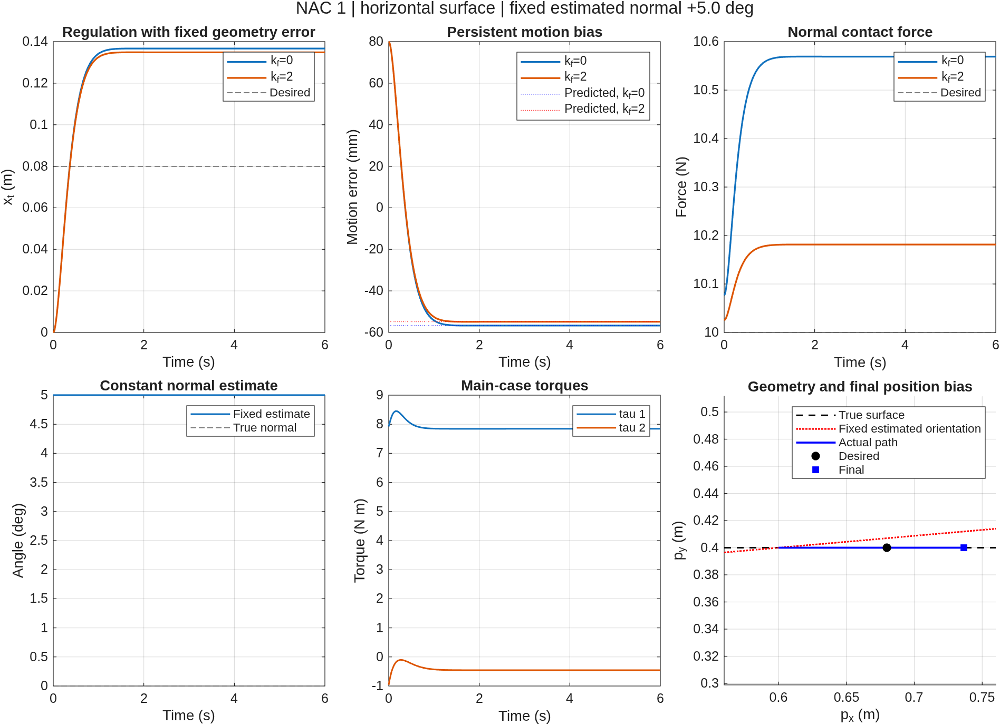

# NAC 1：固定不准确法向的 Non-Adaptive Control

[English](NAC1.md) | [简体中文](NAC1.zh.md)

`nac1_simulation.m` 是独立 MATLAB ODE 仿真，不调用 FIC、IAC 或它们的参数文件。控制器采用 FIC 1 的笛卡尔控制律，将真实法向替换为 IAC 1 主工况的初始有效估计法向，并始终固定该估计。

## 只运行 NAC 1

```matlab
results = nac1_simulation;
results = nac1_simulation(struct('visible','off')); % 保存图像，不显示窗口
results = nac1_simulation(struct('makePlots',false,'saveResults',false));
```

可设置 `initialAngleDeg`、`initialVelocity`、`duration`、`outputDir`、`makePlots`、`saveResults`、`visible`、`initialAngleLimitDeg` 和 `enforceOperatingRegion`。`initialAngleDeg` 在此表示整个仿真中固定的估计角度；默认 +5°，默认限制为 ±6°。联合入口会把所选 IAC 扇区半宽传作 `initialAngleLimitDeg`，以便两者使用相同初始角度。内部角度使用弧度。默认仿真时长 6 秒，输出间隔 0.002 秒；时长至少为 6 秒，以执行稳态检查。

`enforceOperatingRegion` 默认 true，离开原认证区域即报错。max angle 的 +15° 对比显式设置为 false，使 NAC 可在同一个精确、可达且非奇异的机器人模型上继续积分；原区域仍逐点检查，越界状态和首次越界采样时间明确保存。该选项不改变机器人模型、控制器或 IAC 的认证区域。

如需运行并比较 FIC 1、NAC 1、IAC 1，请使用另一个入口：

```matlab
comparison = fic1_nac1_iac1_simulation;
```

它会重新运行三个独立实现，输出至 `results/fic1_nac1_iac1/`，不会覆盖单独 NAC 1 的 `results/nac1/`。普通与 max angle 对比入口的选项和结果布局见 [FIC1_NAC1_IAC1.zh.md](FIC1_NAC1_IAC1.zh.md)。

## 与 FIC 1、IAC 1 对齐的主工况

| 项目 | 默认值 |
| --- | --- |
| 真实接触面、法向 | 水平面 `y=0.4 m`，`n=[0;1]` |
| 机器人 | 两连杆，长度 0.6、0.5 m，质量 2、1.5 kg，均匀杆质心与转动惯量 |
| 初始位置、速度 | `p0=[0.6;0.4] m`，零初速，接触已建立 |
| 调节参考 | `pd=[0.68;0.4] m` |
| 增益与期望力 | `kp=25`、`kv=10`、`fd=10 N`，主工况 `kf=0` |
| 积分器 | `ode45`，`RelTol=1e-9`、`AbsTol=1e-11`、`MaxStep=0.01` |
| 运行区域 | `x_t` 在 (−0.04,0.16) m 内，`q2` 在 (70°,115°) 内 |

三者的区别是法向信息：FIC 1 使用真实法向；NAC 1 始终使用固定 +5° 估计；IAC 1 从 +5° 开始，通过估计律修正有效法向。NAC 1 没有估计器状态、动量修正或法向更新。

NAC 1 默认运行定点调节的 `kf=0`、`kf=2` 两组工况，与 IAC 1 主工况直接对应的是 `regulation, kf=0`。`kf=2` 用于观察保留标量力反馈的 FIC 1 形式。FIC 的补充时变参考跟踪不包含在 NAC 1 默认测试中：固定 +5° 偏差下，该任务会越过原有运行区域，本实现保持相同区域且不会放宽它来继续积分。

## 控制律和真实刚性接触模型

固定法向为

$$
\hat n_\mathrm{fix}=\begin{bmatrix}-\sin\hat\theta_\mathrm{fix}\\\cos\hat\theta_\mathrm{fix}\end{bmatrix},\qquad
\hat\theta_\mathrm{fix}=5^\circ.
$$

控制器保持 FIC 1 的形式：

$$
u_p=\ddot p_d+k_v(\dot p_d-\dot p)+k_p(p_d-p),\qquad
u_f=f_d+k_f(f_d-f),
$$
$$
F=\eta+\Lambda u_p-\hat n_\mathrm{fix}u_f,\qquad \tau=J^TF.
$$

真实法向不进入控制器，参考也不投影到估计的斜面。真实几何仅用于物理模型和离线验证。ODE 积分 `[x_t;dot_x_t]`，通过真实刚性接触的最小坐标恢复位置和关节状态。

为正确处理 `kf>0` 的瞬时力反馈，将 `F0=eta+Lambda*up-nHat*(1+kf)*fd` 代入原始关节动力学，并求解：

```text
[M  -J'*(n+kf*nHat)] [ddot_q] = [J'*F0-C*dot_q-G]
[n'*J             0] [f     ]   [-n'*dot_J*dot_q ]
```

接触反力来自该约束方程，没有直接赋值为 10 N，也没有截断负反力。模型包含构型相关惯量、科氏项和重力。

## 固定偏角的预期后果与校验

令 `z=theta_fix-theta`、`Lambda_t=T'*Lambda*T`、`r_Lambda=(T'*Lambda*n)/Lambda_t`，以及 `rho=cos(z)+r_Lambda*sin(z)`。则在当前刚性接触支路上：

$$
f=\frac{(1+k_f)\rho}{1+k_f\rho}f_d,\qquad
\ddot e_t+k_v\dot e_t+k_pe_t=-\frac{u_f\sin z}{\Lambda_t}.
$$

主工况 `kf=0` 时，`f=rho*fd`。固定非零角度误差使运动环持续受到偏置输入，通常产生非零位置和力误差。由于 `Lambda_t` 与 `rho` 随位置变化，程序用 `fzero` 独立求解非线性调节平衡点，核对 ODE 末端误差和接触力。

所有工况检查关节与笛卡尔动力学、实际反力与上述力公式、运动误差方程、法向约束、正接触反力、固定角度和运行区域。调节工况还检查其接近独立预测的平衡点。将 `initialAngleDeg` 设置为 0 时，会额外与 FIC 1 目标误差方程的矩阵指数解析解核对。

默认输出在 `results/nac1/`：`nac1_results.mat`、两组 CSV、`summary.csv`、`verification.txt`，以及 `nac1_summary.png/.fig`。返回值的 `results.cases(1)` 是与 FIC 1、IAC 1 对齐的主工况。

## 本机验证结果

MATLAB R2026a 的静态检查无诊断。默认 +5° 工况下，6 秒结果与独立求解的平衡点一致：

| 工况 | 位置误差 `pd-p` 的切向分量 | 接触力 |
| --- | --- | --- |
| 主工况 `kf=0` | −56.656174 mm | 10.569073672 N |
| 补充工况 `kf=2` | −54.833925 mm | 10.181432523 N |

额外运行的零偏角回归测试与独立 FIC 1 的位置、接触力结果一致；−5° 测试也通过了平衡点与动力学校验。离线读取三套独立保存的结果，核对了机器人参数、真实几何、初始状态、参考、增益、运行区域及全部输出时刻，并确认 NAC 1 与 IAC 1 在初始时刻的力矩命令和反力相同。

三控制器对比图现在由专门的 `fic1_nac1_iac1_simulation` 入口生成，位置为 `results/fic1_nac1_iac1/comparison.png/.fig`。此前临时脚本生成的旧对比图归档在三控制器目录的 `legacy_offline/` 下，单独 NAC 1 的目录只保留自身输出。

数值验证沿用精确模型、理想执行器、无摩擦刚性接触和精确标量力测量的假设；不包含接触建立、碰撞或脱离后的模式切换。

<!-- simulation-figures -->
## 仿真结果图

**独立 NAC 1：固定 +5° 法向，kf=0 与 kf=2 调节结果**


