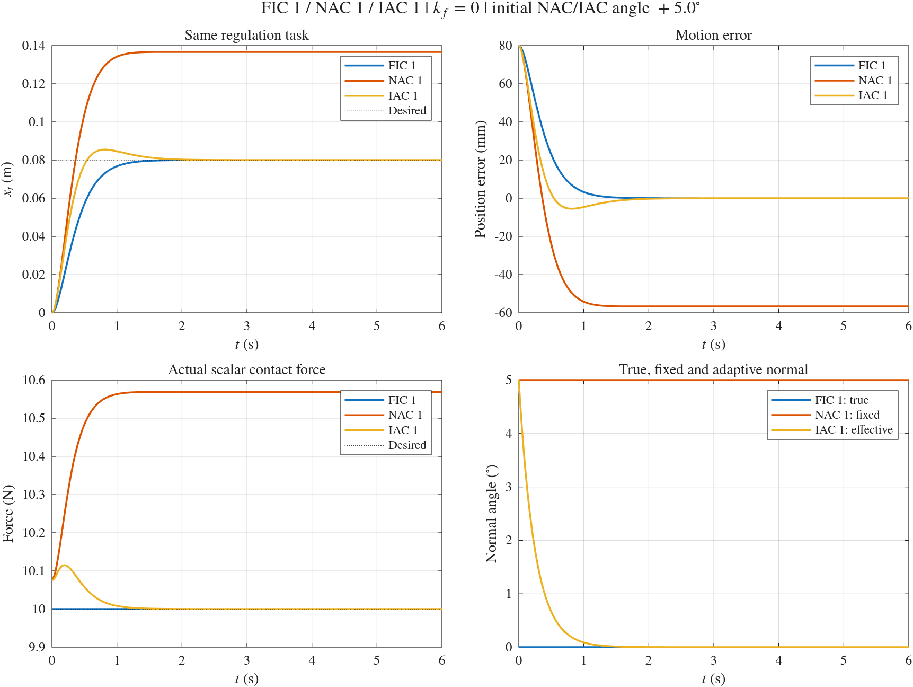
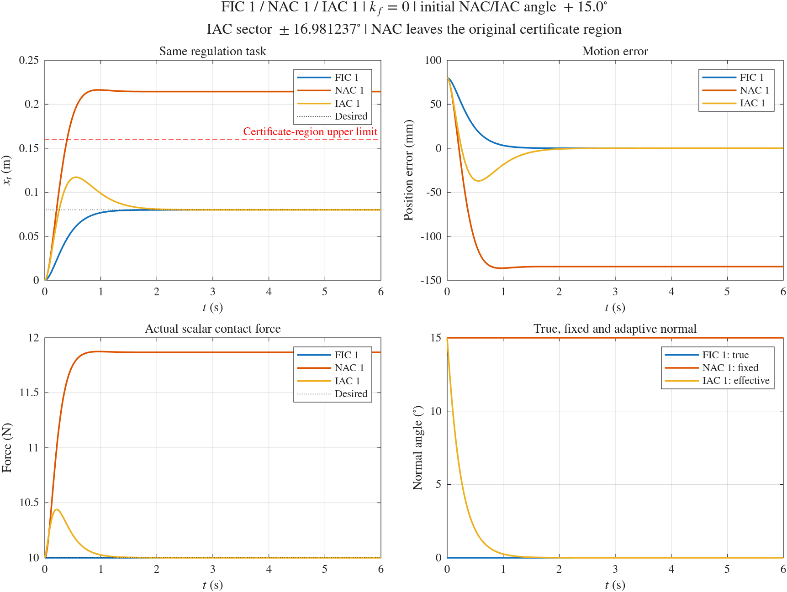

# HMFC Numerical Simulations

[English](README.md) | [简体中文](docs/zh-cn/README.md)

See the [shared numerical API](docs/NUMERICAL_API.md) for options, common run fields, CSV columns and migration from the previous interface.

This project uses a two-link robot in a vertical plane with frictionless rigid contact to numerically verify full-information control (FIC), non-adaptive control with a fixed inaccurate normal (NAC), and immersion and invariance (I&I) adaptive control (IAC). It compares motion errors, contact forces, normal estimates, and joint torques, and checks the implementations against constrained dynamics and theoretical identities.

The ODE simulations require only base MATLAB and have been verified in **MATLAB R2026a**. The optional [physical Simscape comparison](../simscape/docs/FIC1_SIMSCAPE.md) requires Simulink, Simscape and Simscape Multibody. The theoretical source is `obsidian-vault/04-writing/tcst26/TCST26E3.md` in the neighboring Obsidian repository; that repository is not a runtime dependency.

## Project setup and layout

Open [hmfc.prj](../hmfc.prj) in the repository root. Its startup function configures the numerical sources, helpers and optional Simscape sources. The Project panel provides shortcuts for the standard comparison, maximum-angle comparison and test suite. Source files are labelled Design, tests Test, and documentation Artifact. Tests, documentation and generated results are excluded from the runtime search path.

For numerical work alone, change to this `numerical/` folder and run:

```matlab
setup_numerical;
results = fic1_nac1_iac1_simulation;
run_numerical_tests;
```

Or run `setup_project` from the repository root to initialize both simulation families. Both setup functions are repeatable and leave the working folder unchanged. Numerical initialization and simulations require only base MATLAB.

```text
hmfc/
├── hmfc.prj                 # One MATLAB Project for the repository
├── setup_project.m          # Project startup and optional Simulink folders
├── numerical/
│   ├── *_simulation.m       # FIC, NAC, IAC and combined runners
│   ├── setup_numerical.m    # Numerical-only initialization
│   ├── run_numerical_tests.m
│   ├── shared/              # Parameters, robot models and common helpers
│   ├── tests/               # Numerical and project tests
│   ├── docs/                # English/Chinese guides and figure snapshots
│   └── results/             # Generated outputs and retained archives; ignored
├── simscape/                # Physical sources, tests, docs and generated outputs
├── docs/                    # Project overview translations
└── resources/project/       # Native MATLAB Project metadata
```

All numerical defaults resolve to `numerical/results/`, independently of the working folder. Existing numerical outputs and figure snapshots have been moved here. Saved historical MAT files retain their original provenance metadata. Both families read the same parameters from `numerical/shared/hmfc_parameters.m`; Simscape also calls FIC for its ODE comparison. The numerical suite does not require Simscape.

Run all checks from any initialized working folder with `run_numerical_tests`.

## Quick start

Set the MATLAB working directory to the project root, then choose a simulation:

```matlab
% Standard case: rerun and compare FIC 1, NAC 1, and IAC 1, with +5° initial error
comparison = fic1_nac1_iac1_simulation;

% Max angle case: sector near the half-width supremum, with +15° initial error
wide = fic1_nac1_iac1_max_angle_simulation;

% Run NAC 1 only
nacResults = nac1_simulation;

% Run IAC 1 only
iacResults = iac1_simulation;

% Run FIC 1–4 and check pairwise equivalence of the four implementations
ficResults = fic_simulation;
```

By default, figures are displayed and results are saved. The three-controller entry points perform fresh, separate ODE integrations, check the common conditions, and compare each controller's main regulation case. Individual controllers can also run independently.

## Controllers and entry points

| Controller | Normal information and control approach |
| --- | --- |
| FIC 1–4 | The true normal is known. Different reference coordinates and error representations are used; equivalence is checked for the same task. |
| NAC 1 | Uses the FIC 1 law with the true normal replaced by a fixed initial estimate, without an angle update. |
| IAC 1 | Starts with an inaccurate normal, integrates an internal estimate, and uses a momentum correction to construct and adapt the effective estimate. |

| Purpose | MATLAB entry point | Default result directory |
| --- | --- | --- |
| FIC 1 only | `fic_simulation(struct('controllerIds',1))` | `numerical/results/fic1/` |
| FIC 2, 3, or 4 only | `fic_simulation(struct('controllerIds',2))`, `fic_simulation(struct('controllerIds',3))`, `fic_simulation(struct('controllerIds',4))` | `numerical/results/fic2/`, `fic3/`, or `fic4/`, respectively |
| Compare FIC 1 and FIC 2 | `fic_simulation(struct('controllerIds',[1 2]))` | `numerical/results/fic12/` |
| Compare FIC 1–3 | `fic_simulation(struct('controllerIds',1:3))` | `numerical/results/fic123/` |
| Compare FIC 1–4 | `fic_simulation` | `numerical/results/fic1234/` |
| Compare any subset, e.g. FIC 2 and 4 | `fic_simulation(struct('controllerIds',[2 4]))` | `numerical/results/fic24/` |
| NAC 1 only | `nac1_simulation` | `numerical/results/nac1/` |
| IAC 1 only | `iac1_simulation` | `numerical/results/iac1/` |
| Standard +5° three-controller comparison | `fic1_nac1_iac1_simulation` | `numerical/results/fic1_nac1_iac1/` |
| Max angle / +15° three-controller comparison | `fic1_nac1_iac1_max_angle_simulation` | `numerical/results/fic1_nac1_iac1_max_angle/` |

FIC 1–4 share FIC verification code. FIC, NAC 1 and IAC 1 use common robot-model helpers while retaining separate controller laws, contact solves, integrations and controller-specific checks. The three-controller entry points handle execution, condition matching, and presentation.

## Common model and conditions

| Item | Setting |
| --- | --- |
| Robot | Vertical planar 2R arm; link lengths 0.6 and 0.5 m; masses 2 and 1.5 kg |
| Centers of mass and moments of inertia | Uniform rods; gravity, Coriolis terms, and configuration-dependent inertia are retained explicitly |
| True contact surface | Horizontal line `y=0.4 m`, with true normal `[0;1]` |
| Initial state | Contact point `[0.6;0.4] m`; zero initial velocity in the main case; contact already established |
| Regulation reference | `[0.68;0.4] m`, an 8 cm displacement along the surface |
| Motion gains and desired force | `kp=25`, `kv=10`, `fd=10 N`; the main three-controller comparison uses `kf=0` |
| IAC parameters | `gamma=0.4`; sector center at 0° |
| Integration and output | `ode45`; 6 s by default; 0.002 s output spacing; `MaxStep=0.01` |
| Original certified operating region | Tangential displacement `x_t` in (−0.04,0.16) m and elbow angle `q2` in (70°,115°) |

The ODE uses minimal coordinates on the true contact surface to avoid normal constraint drift. The reaction is solved from the robot dynamics and rigid constraint together; it is not assigned the desired force, and no contact penalty spring is introduced. IAC integrates the internal state `hat_theta` and computes the effective estimate from the actual momentum correction, rather than directly integrating the derived parameter-error equation.

The individual entry points also run supplementary checks: FIC includes regulation, tracking, and `kf=0,2`; NAC includes regulation with both force gains; IAC includes the opposite initial tilt, manifold invariance, and regulation at the initial position. Three-controller comparison figures and summary tables select only the respective main regulation cases.

## Standard and max angle cases

| Item | Standard case | Max angle case |
| --- | --- | --- |
| Fixed NAC angle / initial effective IAC angle | +5° | +15° |
| Normal angle used by FIC | True angle, 0° | True angle, 0° |
| IAC sector half-width | 6° | Approximately 16.9812372138° |
| Sector configuration | Default closed sector | Supremum of approximately 16.9812382138°, minus a positive `1e-6°` margin |
| NAC check of the original certified region | An exit raises an error | The original region is retained; physical integration continues and the exit is recorded explicitly |

The sector supremum is computed automatically from the current inertia bounds. At equality, the uniform contact-force lower bound becomes zero, so the max angle case keeps a positive margin on the admissible side. This changes the sector and initial estimate for that case without changing the standalone or standard comparison defaults.

In the verified +15° main case, NAC 1 leaves the original certified region at approximately 0.400 s and then continues on the same exact, reachable, nonsingular robot model. A region exit means leaving the region used for the theoretical analysis; it does not itself imply contact loss or divergence. The original region's guarantees cannot be applied directly to the NAC trajectory after its exit. IAC 1 and FIC 1 continue to enforce the original region checks.

Read these fields together in the three-controller return value:

```matlab
wide.summary                      % Errors, contact forces, angles, and region status
wide.allChecksPassed              % Whether enabled numerical consistency checks passed
wide.allStayedInOperatingRegion   % Whether all three stayed in the original region
wide.nac1.runs(1).firstRegionExitTime
wide.angleAnalysis                % Sector calculation for the max angle case
```

`allChecksPassed=true` does not imply `allStayedInOperatingRegion=true`. In the +15° case, NAC's region status is false, as noted in the figures and reports.

## Headless execution and custom outputs

The FIC, NAC, IAC, and three-controller entry points accept an options struct:

```matlab
% Save figures without opening figure windows
comparison = fic1_nac1_iac1_simulation(struct('visible','off'));
wide = fic1_nac1_iac1_max_angle_simulation(struct('visible','off'));

% Disable plotting while still saving results
comparison = fic1_nac1_iac1_simulation(struct('makePlots',false));

% Select a three-controller output directory
comparison = fic1_nac1_iac1_simulation( ...
    struct('outputDir',fullfile(hmfc_numerical_root(),'results','custom_comparison')));

% IAC 1 only: compute and verify without saving or plotting
iacResults = iac1_simulation(struct('makePlots',false,'saveResults',false));
```

All numerical entry points accept an `options` struct with `makePlots`, `saveResults`, `visible`, `outputDir`, `duration`, and `initialVelocity`. FIC additionally accepts `controllerIds`. Omit all arguments to run FIC 1–4, or select any distinct IDs from 1 to 4:

```matlab
ficResults = fic_simulation(struct('controllerIds',1:4,'makePlots',false));  % All four, without plots
selected = fic_simulation(struct('controllerIds',[1 3],'makePlots',false)); % Only FIC 1 and 3, with equivalence checks
ficResults = fic_simulation(struct('controllerIds',1:4,'outputDir',fullfile(hmfc_numerical_root(),'results','custom_fic')));
```

To run from a terminal in the project root:

```bash
matlab -batch "setup_project; comparison = fic1_nac1_iac1_simulation(struct('visible','off'));"
```

See the documentation below for all options and controller equations.

## Results and verification

Results are generated in each entry point's `numerical/results/` subdirectory. The directory is ignored by `.gitignore`. Reusing an output directory updates files with matching names.

The three-controller directory mainly contains:

- `comparison.png`, `comparison.fig`: comparisons of position, motion error, contact force, and normal angle.
- `summary.csv`, `verification.txt`: main-case metrics and check reports for the three controllers.
- `fic1_primary.csv`, `nac1_primary.csv`, `iac1_primary.csv`: main-case samples with a common set of fields.
- `fic1_nac1_iac1_results.mat`: complete results, including `fic1`, `nac1`, `iac1`, `runs`, and `summary`.
- `fic1/`, `nac1/`, `iac1/`: raw outputs from the three independently executed simulations.
- `initial_angle_analysis.txt`: an additional max angle output recording the supremum, actual half-width, and numerical margin.

The combined runner assigns a separate subdirectory to each constituent simulation, preserving standalone default outputs. The previous +6° max angle results are archived in `numerical/results/fic1_nac1_iac1_max_angle_6deg/`.

Built-in checks cover joint and Cartesian dynamics residuals, contact constraints, positive reaction, motion-error identities, operating regions, and controller-specific predictions: analytical error solutions and implementation equivalence for FIC; nonlinear equilibrium points for NAC; and the effective angle-error equation, exponential envelope, and manifold invariance for IAC. The three-controller runner also matches model parameters, initial states, references, gains, and output sampling times.

The model assumes exactly known dynamics, ideal actuators, frictionless rigid contact, and exact scalar force measurements where required. Analysis starts with established contact and zero normal velocity. It excludes contact establishment, impacts, mode transitions after contact loss, measurement noise, and torque saturation.

## Comparison previews

Figure snapshots are stored alongside the documentation in `numerical/docs/figures/`, independently of the Git-ignored `numerical/results/` directory. See each detailed guide for its full result gallery; FIC groups can be expanded. Simulations still write raw outputs to `numerical/results/`.

**Standard +5° three-controller comparison**



**Max angle / +15°: NAC leaves the original region; IAC stays inside and converges**



## Files and detailed documentation

| File | Purpose |
| --- | --- |
| `../hmfc.prj`, `../resources/project/Project.xml` | Native MATLAB project, managed files, source paths, and startup registration |
| `../setup_project.m` | Repeatable initialization for project paths and Simulink generated folders |
| `numerical/shared/hmfc_parameters.m` | Common robot, contact scene, gains, initial state, and sampling defaults |
| `numerical/shared/hmfc_robot_model.m`, `numerical/shared/hmfc_robot_state.m`, `numerical/shared/hmfc_*kinematics.m`, `numerical/shared/hmfc_jacobian.m` | Shared robot dynamics, state reconstruction and kinematics |
| `numerical/fic_simulation.m` | Unified FIC 1–4 entry point, controller selection, shared robot-model calls, plots, and pairwise equivalence checks |
| `numerical/nac1_simulation.m` | NAC 1 controller, contact solve, and verification using the shared robot model |
| `numerical/iac1_simulation.m` | IAC 1 adaptive law, contact solve, and verification using the shared robot model |
| `numerical/fic1_nac1_iac1_simulation.m` | Three-controller execution, condition matching, and comparison outputs |
| `numerical/fic1_nac1_iac1_max_angle_simulation.m` | Comparison configuration with a near-supremum sector and +15° initial angle |

- [FIC 1–4: equations, conditions, and equivalence checks](docs/FIC.md)
- [NAC 1: fixed normal, steady bias, and options](docs/NAC1.md)
- [IAC 1: momentum correction, adaptive law, and sector conditions](docs/IAC1.md)
- [FIC 1 / NAC 1 / IAC 1: standard and max angle comparisons](docs/FIC1_NAC1_IAC1.md)
- [Two-DOF WAM experiments: controller laws, simulation targets, and required conversions](docs/wam7-exp-guide.md)
