# FIC 1 / FIC 2 / FIC 3 / FIC 4: MATLAB ODE Verification

[English](FIC.md) | [简体中文](zh-cn/FIC.md)

See the [shared numerical API](NUMERICAL_API.md) for options, common run fields, CSV columns and migration from the previous interface.

Open [hmfc.prj](../../hmfc.prj), or run [setup_project](../../setup_project.m) from the repository root, to configure the `numerical/`, `simscape/`, and `numerical/shared/` paths.

Following **FIC 1: Task-Space Tracking**, **FIC 2: Task-Space Tracking with Intrinsic Reference**, **FIC 3: Intrinsic Coordinate Tracking**, and **FIC 4: Intrinsic Coordinate Tracking with Task Space Reference** in `../obsidian-vault/04-writing/tcst26/TCST26E3.md`, this simulation uses the appendix's vertical planar 2R arm to verify regulation, time-varying tracking, and equivalence of the four controllers. Only base MATLAB is required; Simulink, Robotics Toolbox, and Optimization Toolbox are not needed.

The four FIC main regulation cases match the standalone `numerical/iac1_simulation.m`: the same robot, horizontal contact surface, initial position and velocity, reference, motion gains, desired force, duration, and output times. FIC knows the true normal; the main IAC 1 case starts with a +5° effective angle error. FIC `regulation, kf=0` provides the corresponding full-information baseline. Common physical and task defaults come from `numerical/shared/hmfc_parameters.m`; the simulations share robot-model helpers while retaining separate controllers and contact solves. See [IAC1.md](IAC1.md).

The independent entry point `nac1_simulation` provides **NAC 1** under the same conditions. It replaces the true normal in FIC 1 with a fixed +5° initial estimate to examine position and force bias without adaptation. See [NAC1.md](NAC1.md) for usage and verification equations.

## Running the simulations

Use `fic_simulation(options)` for any FIC selection; NAC and IAC use the same options convention in their own entry points:

| Purpose | MATLAB command | Default result directory |
| --- | --- | --- |
| FIC 1 only | `fic1Results = fic_simulation(struct('controllerIds',1));` | `numerical/results/fic1/` |
| NAC 1 only | `nacResults = nac1_simulation;` | `numerical/results/nac1/` |
| IAC 1 only | `iacResults = iac1_simulation;` | `numerical/results/iac1/` |
| Run and compare FIC 1, NAC 1, and IAC 1 | `comparison = fic1_nac1_iac1_simulation;` | `numerical/results/fic1_nac1_iac1/` |
| Comparison near the sector half-width supremum, with +15° initial error | `wide = fic1_nac1_iac1_max_angle_simulation;` | `numerical/results/fic1_nac1_iac1_max_angle/` |

The three-controller runner reruns the independent simulations, matches the conditions, and saves comparison plots and summaries separately. See [FIC1_NAC1_IAC1.md](FIC1_NAC1_IAC1.md).

The default IAC sector in the standard simulations remains ±6°. The max angle case uses a closed sector with half-width approximately 16.981238° minus `1e-6°`, and a +15° initial angle. The original +5° case is preserved, and the previous +6° outputs are archived separately. Whether NAC leaves the original certified region under the larger error is recorded explicitly; see the [standard and max angle guide](FIC1_NAC1_IAC1.md).

Set the MATLAB working directory to the project root and run:

```matlab
results = fic_simulation;
```

Disable plotting or select an output directory:

```matlab
results = fic_simulation(struct('controllerIds',1:4,'makePlots',false));
results = fic_simulation(struct('controllerIds',1:4,'outputDir',fullfile(pwd,'my_results')));
```

Select one controller or any subset through the same entry point:

```matlab
fic1Results = fic_simulation(struct('controllerIds',1));     % FIC 1 only; numerical/results/fic1/
fic2Results = fic_simulation(struct('controllerIds',2));     % FIC 2 only; numerical/results/fic2/
fic3Results = fic_simulation(struct('controllerIds',3));     % FIC 3 only; numerical/results/fic3/
fic4Results = fic_simulation(struct('controllerIds',4));     % FIC 4 only; numerical/results/fic4/
fic12Results = fic_simulation(struct('controllerIds',[1 2])); % Compare FIC 1 and 2; numerical/results/fic12/
fic123Results = fic_simulation(struct('controllerIds',1:3));  % Compare FIC 1–3; numerical/results/fic123/
selected = fic_simulation(struct('controllerIds',[2 4],'makePlots',false)); % Any subset; numerical/results/fic24/, no plots
```

IDs must form a nonempty vector of distinct integers from 1 to 4. Row and column vectors are accepted, and their order determines comparison columns and the output tag: `[4 2]` writes to `numerical/results/fic42/`. Invalid selections are rejected before creating output files. The seven separate single/combined FIC entry-point files have been replaced by this interface.

Every selection returns grouped `.robot`, `.plant`, `.controller`, `.task`, plus `.options`, `.runs`, `.summary`, `.checks` and `.allChecksPassed`. A single selection exposes its ID as `.controller.id`. Multiple selections additionally return the selected `.ficN` results, `.comparison` and `.comparisonSummary`; `.runs` collects all selected runs, retaining optional diagnostics. For `n` controllers, summaries contain `4*n` case rows and `4*n*(n-1)/2` pairwise rows. Two-controller difference plots use `equivalence.png/.fig`; larger selections use `equivalence_i_j.png/.fig`. Custom output roots retain this same layout.

The four-controller runner defaults to `numerical/results/fic1234/` and displays individual and side-by-side results:

- `fic1/`, `fic2/`, `fic3/`, `fic4/`: complete outputs for each controller.
- `comparison/regulation_kf_0.png/.fig`, `regulation_kf_2.png/.fig`: four-column regulation comparisons, ordered FIC 1, 2, 3, 4 from left to right.
- `comparison/tracking_kf_0.png/.fig`, `tracking_kf_2.png/.fig`: four-column tracking comparisons.
- `comparison/equivalence_i_j.png/.fig`, for pairs 1–2, 1–3, 1–4, 2–3, 2–4, and 3–4: position, acceleration-command, contact-force, and joint-torque differences for each pair across the four matched cases.
- `comparison/summary.csv`: maximum differences for six controller pairs and four cases per pair, totaling 24 rows, including `controllerA` and `controllerB` columns.
- `summary.csv`: metrics for all 16 controller/case combinations, including a `controller` column.
- `fic1234_results.mat`: combined results; `results.fic1`, `results.fic2`, `results.fic3`, and `results.fic4` contain each controller's complete data, while `results.comparisonSummary` contains pairwise differences.

Each controller's directory contains:

- `regulation.png/.fig`: regulation trajectory, motion error, contact force, Lyapunov function, and joint torques.
- `tracking.png/.fig`: corresponding outputs for the time-varying reference.
- `diagnostics.png/.fig`: force error, constraint residuals, motion-error equation residuals, joint dynamics residuals, analytical-solution differences, and nonsingularity margin.
- `summary.csv`: metrics for the four cases.
- `fic1_results.mat`, `fic2_results.mat`, `fic3_results.mat`, or `fic4_results.mat`: parameters, integrator settings, complete sampled signals, analytical solutions, metrics, and checks.

To run from the command line without figure windows:

```bash
matlab -batch "setup_project; set(groot,'defaultFigureVisible','off'); results = fic_simulation;"
```

Run the controller-selection and output-layout tests from the project root:

```matlab
assertSuccess(runtests('numerical/tests/test_fic_simulation.m'));
```

## Control laws and rigid-contact solution

FIC 1 receives three Cartesian reference vectors $p_d,\dot p_d,\ddot p_d$. FIC 2 receives three intrinsic reference scalars $x_{t,d},\dot x_{t,d},\ddot x_{t,d}$ and first converts them using the true geometry:

$$
p_d=p_0+Tx_{t,d},\qquad \dot p_d=T\dot x_{t,d},\qquad \ddot p_d=T\ddot x_{t,d}.
$$

Both then apply the source document's Cartesian feedback law:

$$
u_p=\ddot p_d+k_v(\dot p_d-\dot p)+k_p(p_d-p),\qquad
u_f=f_d+k_f(f_d-f),
$$
$$
F=\eta+\Lambda u_p-nu_f,\qquad \tau=J^TF.
$$

FIC 3 also receives intrinsic references but computes scalar errors directly from measured Cartesian position and velocity:

$$
x_t=T^T(p-p_0),\quad \dot x_t=T^T\dot p,\quad
e_t=x_{t,d}-x_t,\quad \dot e_t=\dot x_{t,d}-\dot x_t,
$$
$$
u_t=\ddot x_{t,d}+k_v\dot e_t+k_pe_t,\qquad u_p=Tu_t.
$$

FIC 3's `intrinsic_control` function does not receive Cartesian references or Cartesian errors. Its Cartesian references and errors are used only for consistent presentation and verification. For regulation, the first and second reference derivatives are zero, so these equations reduce automatically to the source document's regulator.

FIC 3 additionally saves `xt`, `dxt`, `xtd`, `dxtd`, `ddxtd`, `et`, `det`, and `ut`, along with residuals of the scalar error equation and Cartesian error mapping.

FIC 4 receives Cartesian references and first converts them into intrinsic references:

$$
x_{t,d}=T^T(p_d-p_0),\qquad
\dot x_{t,d}=T^T\dot p_d,\qquad
\ddot x_{t,d}=T^T\ddot p_d.
$$

It then calls the same `intrinsic_control` function as FIC 3 to form $u_t$ and $u_p=Tu_t$. FIC 4 saves the intrinsic signals above, plus `pInputd`, `dpInputd`, `ddpInputd`, `referenceNormalOffset`, and `referenceProjectionResidual`. Its `.reference` and `.referenceVelocity` fields are the effective references projected onto the contact line. Default inputs lie on that line, so the two reference representations agree to numerical precision. For an input with a normal offset, the source document's target is the projection $p_{d,\mathcal S}=p_0+TT^T(p_d-p_0)$.

`numerical/shared/` provides the common arm kinematics and dynamics. `numerical/fic_simulation.m` provides the FIC rigid-contact solver, numerical checks, and individual result plots. FIC 1 and 4 call the Cartesian reference generator; FIC 2 and 3 call the intrinsic generator. Each controller performs its own ODE integration. The local `run_comparison` function in the same file compares every selected pair under the same reference mode, gain, and output times, without reusing another controller's trajectory.

The `ode45` state is $z=[s,v]^T$, with $p=p_0+Ts$ and $\dot p=Tv$. Inverse kinematics on a fixed positive-elbow branch reconstructs $q$, and $\dot q=J^{-1}Tv$ gives joint velocity. This coordinate choice enforces the contact geometry exactly, without introducing a rigid-contact spring, damping, or constraint-stabilization parameters. Initially $s=0$, so $p_0=p(0)$ as defined in the note.

Instantaneous force feedback creates an algebraic loop between the controller and reaction. Define

$$
F_0=\eta+\Lambda u_p-n(1+k_f)f_d,\qquad \tau_0=J^TF_0,\qquad J_n=n^TJ.
$$

At every ODE right-hand-side evaluation, solve the original joint dynamics and normal acceleration constraint together:

$$
\begin{bmatrix}
M&-(1+k_f)J_n^T\\
J_n&0
\end{bmatrix}
\begin{bmatrix}\ddot q\\f\end{bmatrix}
=
\begin{bmatrix}
\tau_0-C\dot q-G\\
-n^T\dot J\dot q
\end{bmatrix}.
$$

Then use $\ddot p=J\ddot q+\dot J\dot q$ to obtain $\dot v=T^T\ddot p$. The force $f$ comes from this simultaneous solution. The plant is not assigned $f=f_d$ or $\ddot p=u_p$, and the previous time step's force is not substituted for instantaneous feedback.

## Parameters and cases

Common parameters are defined in `numerical/shared/hmfc_parameters.m`. The note does not prescribe numerical parameters; the following are illustrative choices for verification, using its appendix dynamics.

| Item | Default |
| --- | --- |
| Link lengths $l_1,l_2$ | 0.6 and 0.5 m |
| Link masses $m_1,m_2$ | 2 and 1.5 kg |
| Centers of mass and inertias | $l_{c,i}=l_i/2$, $I_i=m_i l_i^2/12$ |
| Gravitational acceleration | 9.81 m/s²; configuration-dependent gravity is retained and compensated |
| Contact-line orientation | Horizontal line $y=0.4$ m, $n=[0;1]$, $T=[1;0]$ |
| Initial contact and joint positions | $p_0=[0.6;0.4]$ m; $q(0)$ is obtained by inverse kinematics on the same positive-elbow branch |
| Initial tangential velocity | 0 m/s, with zero initial normal velocity |
| Gains | $k_p=25$, $k_v=10$; main baseline $k_f=0$, supplementary test $k_f=2$ |
| Desired contact force | $f_d=10$ N |
| Regulation reference | $p_d=p_0+0.08T=[0.68;0.4]$ m |
| Tracking reference | $p_d(t)=p_0+T[0.08+0.045\sin(0.8t)+0.02\cos(1.3t)]$ |
| Operating region | $x_t\in(-0.04,0.16)$ m, $q_2\in(70°,115°)$ |
| Duration and output spacing | 6 s and 0.002 s, matching default IAC 1 output times |
| `ode45` settings | `RelTol=1e-9`, `AbsTol=1e-11`, `MaxStep=0.01`; the IAC 1 internal estimate state separately uses `AbsTol=1e-12` |

Each controller runs two references and two force-feedback gains, for four cases; the four-controller runner therefore executes 16 cases. FIC 1 and 4 use `cartesian_reference`; FIC 2 and 3 use `intrinsic_reference`. The default references express the same task. Tracking and $k_f=2$ remain supplementary FIC tests, while the negative tilt, manifold invariance, and regulation at the initial position are IAC estimator-specific tests. These supplementary cases do not imply identical references or initial velocities across FIC and IAC.

## Verification criteria and interpretation

The note predicts

$$
\ddot e_p+k_v\dot e_p+k_pe_p=0,\qquad (1+k_f)(f_d-f)=0.
$$

The motion-error poles are a repeated pole at $-5$. The code independently computes the analytical solution of this error equation with `expm` and compares it against the ODE trajectory obtained from the full arm dynamics.

Automatic assertions check:

- Terminal position and velocity errors, and their maximum differences from the analytical solution, are each below $10^{-7}$ in the corresponding SI units.
- Force error; normal position, velocity, and acceleration residuals; joint dynamics residuals; and motion-error equation residuals are each below $10^{-8}$ in the corresponding SI units.
- The contact force independently reconstructed from the Cartesian constraint formula agrees with the simultaneous solution.
- For $V=(\|\dot e_p\|^2+k_p\|e_p\|^2)/2$, the identity $\dot V=-k_v\|\dot e_p\|^2$ holds to numerical precision.
- Trajectories remain in the tangential-coordinate and elbow-angle region above, and Cartesian inertia remains positive definite. The reaction is also checked as positive during solution to verify maintained unilateral contact.
- For the same reference, state trajectories at the two $k_f$ values differ by less than $10^{-7}$.
- FIC 3 and 4 additionally check $\ddot e_t+k_v\dot e_t+k_pe_t=0$, $e_p=Te_t$, and $\dot e_p=T\dot e_t$, with residuals below $10^{-8}$.
- In combined runs, every controller pair's matched cases have maximum differences below $10^{-7}$ in the corresponding SI units for Cartesian references, states, positions, velocities, accelerations, motion commands, force commands, contact forces, and joint torques.

Under the note's exact-model, frictionless, established rigid unilateral-contact assumptions and delay-free scalar force measurement, the force channel is algebraic. It is expected to satisfy $f=f_d>0$ from initialization, without dynamic force-error decay. The ideal results for both $k_f$ values should therefore coincide. Force errors at machine precision do not indicate force oscillation.

With true geometry, FIC 2 and 4 reference conversions are exact, as are the mappings $Te_t=e_p$ and $T\dot e_t=\dot e_p$ in FIC 3 and 4. Thus, the four controllers should coincide numerically for the same reference and gains. Corresponding rows of the side-by-side figures share axis ranges. Difference plots display zero values at a floor of $10^{-16}$; actual values are in `comparison/summary.csv`.

Near-zero geometric contact residuals are guaranteed by the reduced coordinates. Comparisons of dynamics, reactions, and analytical error solutions check consistency between the control law and plant solution. Inertia and Jacobian indicators are checked at numerical evaluation/sample points; they do not prove properties over the entire workspace. Numerical simulation checks ideal-model predictions and does not replace a stability proof. Model errors, compliant contact, noise, delays, torque saturation, and contact establishment are outside this model.

## Measured results

Using MATLAB R2026a with the defaults matched to IAC 1, all 16 cases and 24 pairwise equivalence checks passed. The following summarizes the four implementations. Differences at machine precision arise from the order of reference conversion and scalar-feedback operations.

| Metric | Result |
| --- | --- |
| Regulation position error at 6 s | Approximately 2.32e-13 m |
| Tracking position error at 6 s | Approximately 5.85e-13 m |
| Maximum contact-force error over all cases | Approximately 1.42e-14 N |
| Maximum regulation position difference from the analytical solution | Approximately 3.20e-12 m |
| Maximum tracking position difference from the analytical solution | Approximately 4.68e-12 m |
| Maximum position difference over all controller pairs | Approximately 4.58e-16 m |
| Maximum joint-torque difference norm over all controller pairs | Approximately 1.25e-14 N m |

Contact force remains positive at approximately 10 N, and all trajectories respect the same operating region as IAC 1. `scenario_alignment.txt` in the default combined output directory records condition checks between independently saved results; `summary.csv` and `comparison/summary.csv` contain the complete numerical metrics.

<!-- simulation-figures -->
## Simulation result figures

These snapshots use the current horizontal-surface conditions and 6 s duration. The older FIC 1–2 and FIC 1–3 figures have been regenerated with the current parameters. Individual-controller figures show both force gains; combined figures compare matched references and gains. Expand each group to view its plots. Duplicate individual-controller figures within combined output directories are not repeated.

### FIC 1

<details>
<summary>Show regulation, tracking, and diagnostics</summary>

**FIC 1 — Regulation**

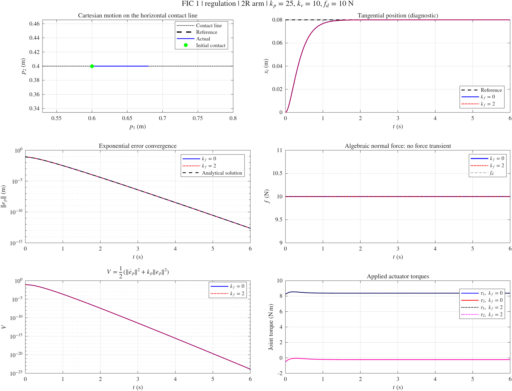

**FIC 1 — Tracking**

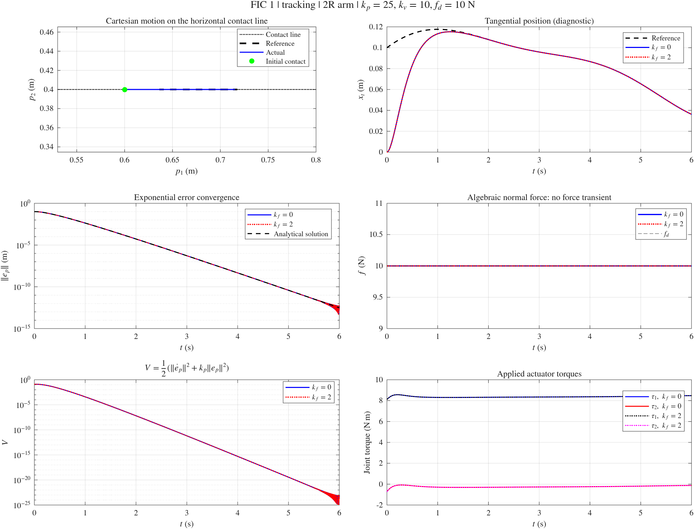

**FIC 1 — Dynamics and constraint diagnostics**


</details>

### FIC 2

<details>
<summary>Show regulation, tracking, and diagnostics</summary>

**FIC 2 — Regulation**


**FIC 2 — Tracking**


**FIC 2 — Dynamics and constraint diagnostics**


</details>

### FIC 3

<details>
<summary>Show regulation, tracking, and diagnostics</summary>

**FIC 3 — Regulation**


**FIC 3 — Tracking**


**FIC 3 — Dynamics and constraint diagnostics**

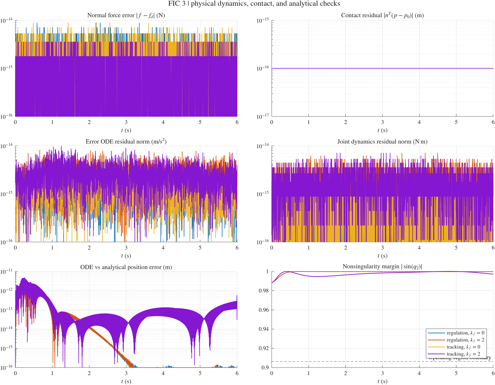


</details>

### FIC 4

<details>
<summary>Show regulation, tracking, and diagnostics</summary>

**FIC 4 — Regulation**


**FIC 4 — Tracking**


**FIC 4 — Dynamics and constraint diagnostics**

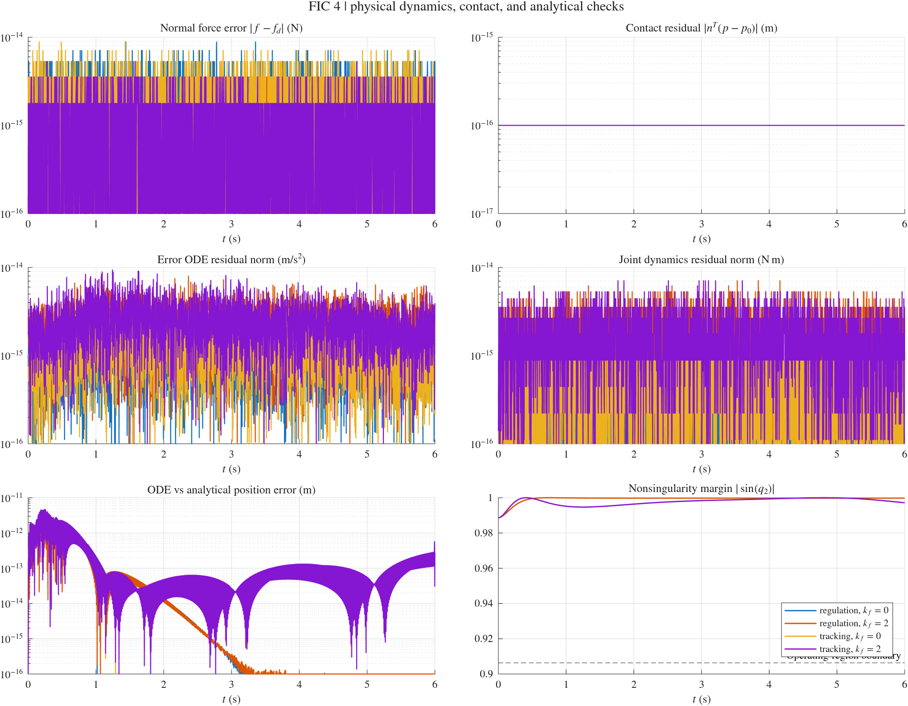


</details>

### FIC 1 / FIC 2

<details>
<summary>Show the four cases and pairwise equivalence results</summary>

**FIC 1 / FIC 2 — Regulation, kf=0**


**FIC 1 / FIC 2 — Regulation, kf=2**

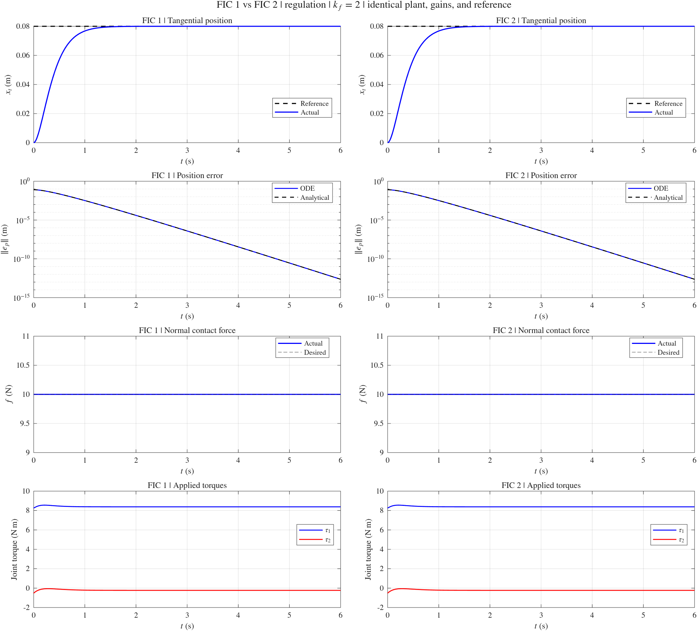

**FIC 1 / FIC 2 — Tracking, kf=0**


**FIC 1 / FIC 2 — Tracking, kf=2**

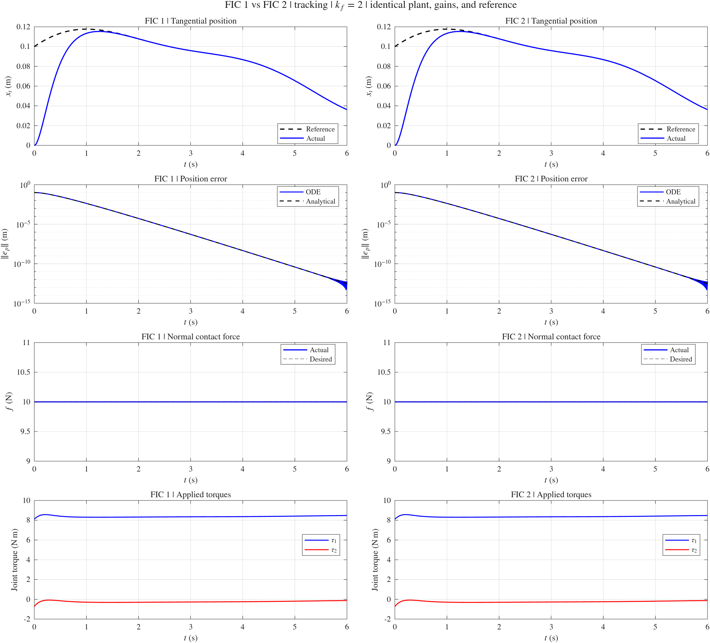

**FIC 1 / FIC 2 — Numerical equivalence**


</details>

### FIC 1 / FIC 2 / FIC 3

<details>
<summary>Show the four cases and pairwise equivalence results</summary>

**FIC 1 / FIC 2 / FIC 3 — Regulation, kf=0**

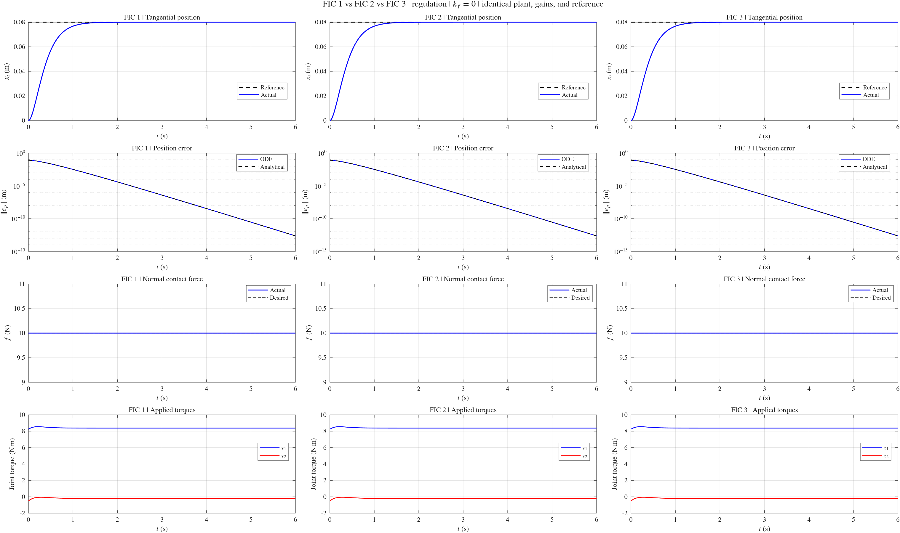

**FIC 1 / FIC 2 / FIC 3 — Regulation, kf=2**


**FIC 1 / FIC 2 / FIC 3 — Tracking, kf=0**

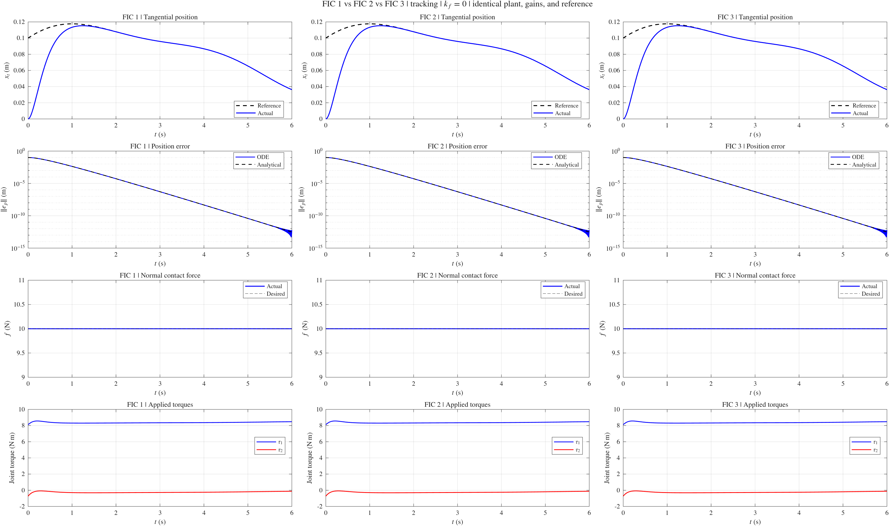

**FIC 1 / FIC 2 / FIC 3 — Tracking, kf=2**


**FIC 1 / FIC 2 — Numerical equivalence**


**FIC 1 / FIC 3 — Numerical equivalence**


**FIC 2 / FIC 3 — Numerical equivalence**


</details>

### FIC 1 / FIC 2 / FIC 3 / FIC 4

<details>
<summary>Show the four cases and pairwise equivalence results</summary>

**FIC 1 / FIC 2 / FIC 3 / FIC 4 — Regulation, kf=0**


**FIC 1 / FIC 2 / FIC 3 / FIC 4 — Regulation, kf=2**

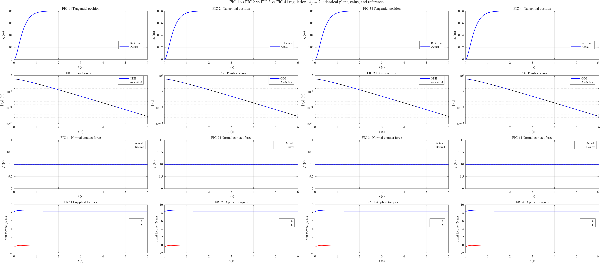

**FIC 1 / FIC 2 / FIC 3 / FIC 4 — Tracking, kf=0**


**FIC 1 / FIC 2 / FIC 3 / FIC 4 — Tracking, kf=2**

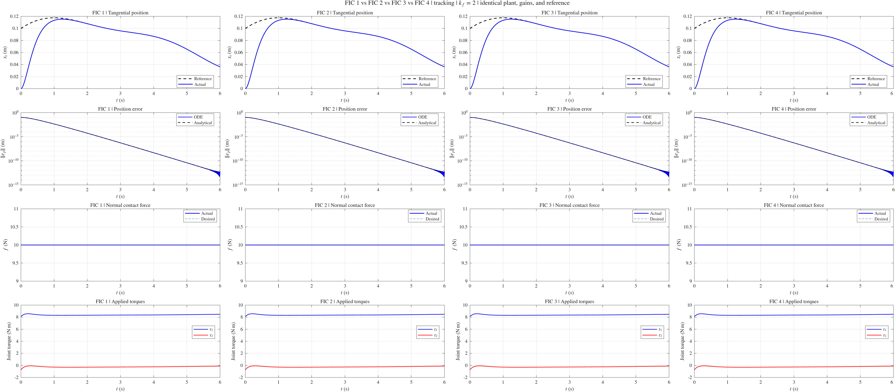

**FIC 1 / FIC 2 — Numerical equivalence**


**FIC 1 / FIC 3 — Numerical equivalence**


**FIC 1 / FIC 4 — Numerical equivalence**


**FIC 2 / FIC 3 — Numerical equivalence**


**FIC 2 / FIC 4 — Numerical equivalence**

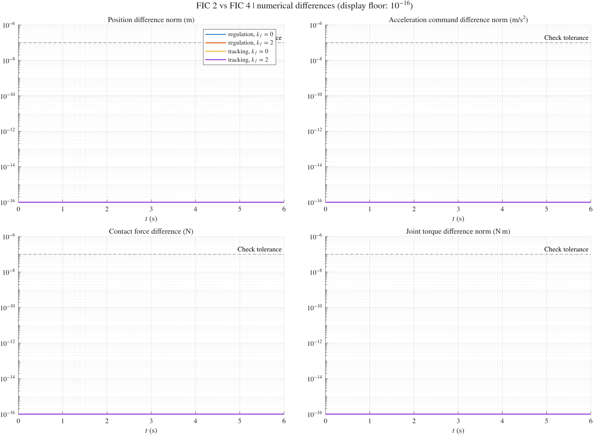

**FIC 3 / FIC 4 — Numerical equivalence**

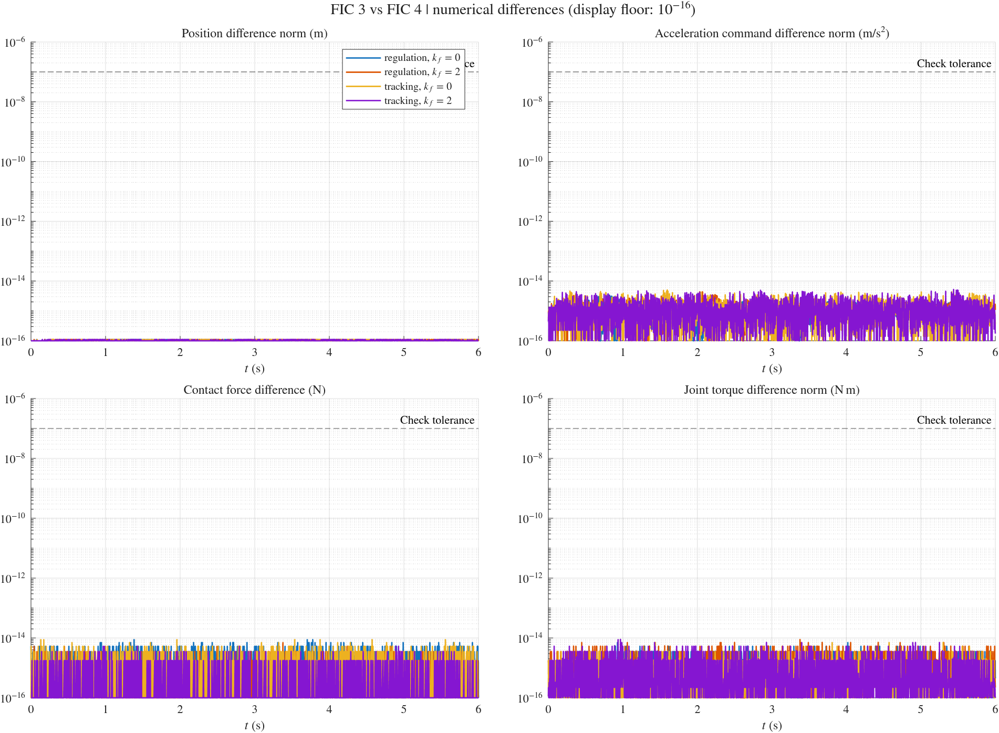


</details>
