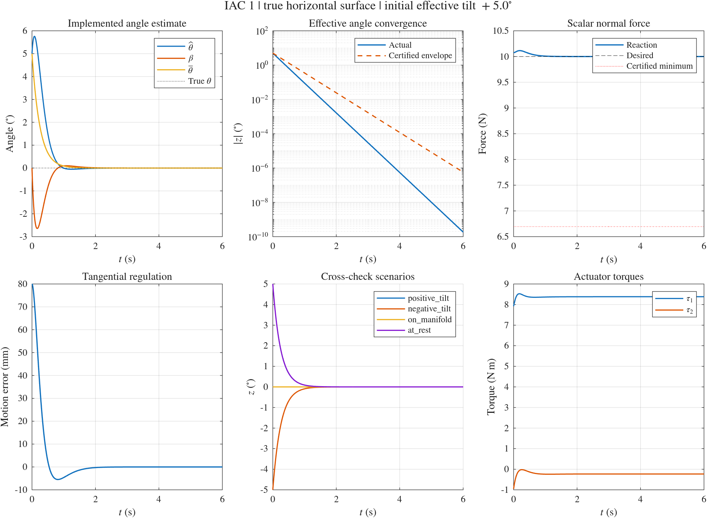

# Standalone MATLAB ODE Simulation of IAC 1

[English](IAC1.md) | [简体中文](zh-cn/IAC1.md)

See the [shared numerical API](NUMERICAL_API.md) for options, common run fields, CSV columns and migration from the previous interface.

Open [hmfc.prj](../../hmfc.prj), or run [setup_project](../../setup_project.m) from the repository root, to configure the `numerical/`, `simscape/`, and `numerical/shared/` paths.

The entry point is `numerical/iac1_simulation.m`, which requires only base MATLAB. The model, controller, estimator, contact-reaction solver, and plotting code are local functions in this file. It does not call or modify any FIC code.

The actual source filename is `obsidian-vault/04-writing/tcst26/TCST26E3.md`, whose top-level title is `TCST26`. This implementation follows **IAC 1: Task-Space Control, Uncertain Surface Angle** and the two-link robot appendix.

The main regulation cases of all four FIC controllers match this simulation's defaults: the same robot parameters, horizontal surface, initial contact position, zero initial velocity, 8 cm target displacement, motion gains, 10 N desired force, 6 s integration, and 0.002 s output spacing. The FIC `regulation, kf=0` case is the full-information baseline; the main IAC 1 case retains a +5° initial estimation error. Common defaults come from `numerical/shared/hmfc_parameters.m`; FIC and IAC share robot-model helpers while retaining separate controllers and contact solves. FIC tracking and other force gains, and IAC estimator cross-checks, remain supplementary tests.

## Running the simulation

`iac1_simulation` runs IAC 1 only. To rerun and compare FIC 1, NAC 1, and IAC 1, use `comparison = fic1_nac1_iac1_simulation;`. Its results are saved separately in `numerical/results/fic1_nac1_iac1/`; see the [three-controller comparison guide](FIC1_NAC1_IAC1.md).

Run from the project root:

```matlab
results = iac1_simulation;
```

Run without figure windows and save the images:

```matlab
results = iac1_simulation(struct('visible','off'));
```

Compute and verify only:

```matlab
results = iac1_simulation(struct('makePlots',false,'saveResults',false));
```

Options are `initialAngleDeg`, `initialVelocity`, `duration`, `outputDir`, `makePlots`, `saveResults`, `visible`, `sectorHalfWidthDeg`, and `sectorMarginDeg`. The initial angle specifies the effective estimate `bar_theta(0)` in degrees and must lie in the selected sector; the default half-width remains 6°. `sectorHalfWidthDeg` accepts a numerical half-width or the string `'supremum'`. The latter computes the strict supremum from the current inertia bounds and subtracts the positive `sectorMarginDeg` margin, which defaults to `1e-6°`. Control equations use radians internally. `duration` must be at least 6 s for the terminal convergence checks. Changes such as increasing the initial velocity must still respect the robot operating region; an exit stops the simulation with an error.

The default closed sector allows a maximum initial effective angle error of 6°. The max angle entry point, `fic1_nac1_iac1_max_angle_simulation`, instead uses a sector near the 16.981238° half-width supremum and a +15° initial angle, with separate three-controller outputs. See the [standard and max angle cases](FIC1_NAC1_IAC1.md).

## Conditions and model

- The true contact surface is the horizontal line `y = 0.4 m`, with the environment below it, true normal `n = [0;1]`, and true angle 0°.
- The initial contact point is `p0 = [0.6;0.4] m`. Contact is already established and the initial normal velocity is zero.
- The main case starts with an effective estimate of +5°, namely `bar_n(0) = [-sin(5°);cos(5°)]`, and zero initial velocity.
- The regulation target is `p_d = [0.68;0.4] m`, with a desired normal force of 10 N.
- The known model is a two-revolute-joint robot in a vertical plane. Link lengths are 0.6 and 0.5 m, masses are 2 and 1.5 kg, centers of mass are at the midpoints, and moments of inertia are those of uniform slender rods. Gravity, Coriolis terms, and configuration-dependent Cartesian inertia are retained explicitly.
- `k_p = 25`, `k_v = 10`, `gamma = 0.4`, nominal angle center 0°, and prior sector ±6°.

Three cross-checks also run: a −5° initial error; zero initial effective angle with a nonzero tangential velocity of 0.02 m/s to check manifold invariance; and a +5° error with the reference at the initial position and zero initial velocity. The last case has no imposed motion excitation, although estimation error still induces transient tangential motion.

The reference lying on the true contact line is an assumption of the source document. The simulation provides such a reference in advance; the controller does not use the true normal to project the reference or error signals.

## Equation implementation

The ODE state is only `[x_t; dx_t; hat_theta]`. True rigid contact is represented by the minimal coordinates `p = p0 + T*x_t`. Inverse kinematics on a fixed elbow branch reconstructs `q`, and `J\dp` reconstructs `dq`. No penalty spring, contact damping, or normal constraint stabilization is used.

The controller implements:

```text
m_p       = Lambda * dp
beta      = -gamma * T_c' * m_p
bar_theta = hat_theta + beta
bar_n     = R(bar_theta) * n0
u_p       = k_p * (p_d - p) - k_v * dp
F         = eta + Lambda * u_p - bar_n * f_d
tau       = J' * F
g_p       = F - eta + dLambda * dp
dhat_theta = gamma * T_c' * (g_p + bar_n * f)
```

`dLambda` is computed analytically from the known model and independently checked by central differences. The internal estimate is initialized as `hat_theta(0) = bar_theta(0) + gamma*T_c'*Lambda(0)*dp(0)`, including cases with nonzero initial momentum.

The physical model solves the following linear constraint equations for the actual acceleration and scalar reaction. The reaction is then supplied to the estimator as the force-sensor reading:

```text
[M      -J'*n] [ddq] = [tau-C*dq-G   ]
[n'*J       0] [f     ]   [-n'*dJ*dq]

ddp = J*ddq + dJ*dq
```

The controller and estimator interfaces contain neither the true `n`, true angle, parameter error `z`, nor measured acceleration. True geometry is used only by the physical model, offline certification, and verification. The derived `dz` equation is not used as the ODE, and the theoretical reaction formula is not used to generate the sensor reading.

## Verification and outputs

On `q2` in [70°,115°], analytic uniform inertia bounds are obtained from the trace and determinant of the two-link inertia. These give the source document's `chi_Lambda`, `rho_min`, contact-force lower bound, and exponential angle envelope. The bounds are not fitted to trajectory samples. Tangential displacement is additionally restricted to [−0.04,0.16] m. The code checks the trajectory and uses ODE events to monitor the operating region, estimation sector, and positive reaction.

Each case automatically checks:

- Residuals of Cartesian dynamics, joint dynamics, and the momentum equation.
- Agreement between `dz` obtained from the implemented controller and the theoretical error equation, together with a central-difference check of the integrated effective angle.
- The reaction identity `f/f_d = cos(z) + r_Lambda*sin(z)` and tangential error dynamics.
- Strictly positive contact force at or above the certified lower bound, sector invariance, and the exponential angle envelope.
- Normal gap, normal velocity, and robot inertia bounds.
- Terminal angle error below `1e-6 rad`, tangential error below `1e-6 m`, velocity below `1e-6 m/s`, and force error below `1e-5 N`.
- Manifold invariance in the case with zero initial effective angle error.

Default outputs go to `numerical/results/iac1/`: the complete `iac1_results.mat`, a CSV for each of the four cases, `summary.csv`, `verification.txt` with errors and residuals, `iac1_summary.png`, and the editable `iac1_summary.fig`. The returned `results.runs` contains all signals and checks.

These are numerical checks under the document's ideal assumptions: exact model, exact scalar force measurement, ideal actuators, and established frictionless rigid contact. The simulation excludes contact establishment, impacts, motion modes after contact loss, and measurement noise. A negative reaction is not clipped to zero to conceal contact failure.

<!-- simulation-figures -->
## Simulation result figures

**Standalone IAC 1: +5° main case, opposite tilt, manifold invariance, and regulation at the initial position**


