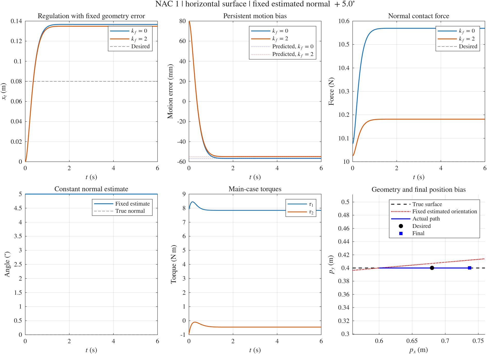

# NAC 1: Non-Adaptive Control with a Fixed Inaccurate Normal

[English](NAC1.md) | [简体中文](zh-cn/NAC1.md)

See the [shared numerical API](NUMERICAL_API.md) for options, common run fields, CSV columns and migration from the previous interface.

Open [hmfc.prj](../../hmfc.prj), or run [setup_project](../../setup_project.m) from the repository root, to configure the `numerical/`, `simscape/`, and `numerical/shared/` paths.

`numerical/nac1_simulation.m` is a standalone MATLAB ODE simulation. Its controller and contact solve remain separate from FIC and IAC. Robot-model helpers and defaults are shared through `numerical/shared/`. It uses the FIC 1 Cartesian control law, replacing the true normal with the initial effective normal estimate from the main IAC 1 case and holding that estimate fixed throughout.

## Running NAC 1 only

```matlab
results = nac1_simulation;
results = nac1_simulation(struct('visible','off')); % Save images without figure windows
results = nac1_simulation(struct('makePlots',false,'saveResults',false));
```

Options are `initialAngleDeg`, `initialVelocity`, `duration`, `outputDir`, `makePlots`, `saveResults`, `visible`, `initialAngleLimitDeg`, and `enforceOperatingRegion`. Here, `initialAngleDeg` is the estimated angle held fixed for the entire simulation; it defaults to +5°, with default limits of ±6°. The combined runner passes the selected IAC sector half-width as `initialAngleLimitDeg` so that both controllers use the same initial angle. Internally, angles use radians. Default duration is 6 s, output spacing is 0.002 s, and duration must be at least 6 s for the steady-state checks.

`enforceOperatingRegion` defaults to true: leaving the original certified region raises an error. The +15° max angle comparison explicitly sets it to false so that NAC can continue on the same exact, reachable, nonsingular robot model. The original region is still checked at every sample, and the exit status and first outside sample time are saved explicitly. This option does not change the robot model, controller, or IAC certificate region.

To run and compare FIC 1, NAC 1, and IAC 1, use the separate entry point:

```matlab
comparison = fic1_nac1_iac1_simulation;
```

It reruns the three independent implementations and saves to `numerical/results/fic1_nac1_iac1/`, preserving the standalone NAC 1 directory `numerical/results/nac1/`. See [FIC1_NAC1_IAC1.md](FIC1_NAC1_IAC1.md) for standard and max angle options and output layouts.

## Main conditions matched to FIC 1 and IAC 1

| Item | Default |
| --- | --- |
| True contact surface and normal | Horizontal surface `y=0.4 m`, `n=[0;1]` |
| Robot | Two links of length 0.6 and 0.5 m, masses 2 and 1.5 kg, and uniform-rod centers of mass and inertias |
| Initial position and velocity | `p0=[0.6;0.4] m`, zero velocity, contact already established |
| Regulation reference | `pd=[0.68;0.4] m` |
| Gains and desired force | `kp=25`, `kv=10`, `fd=10 N`; main case `kf=0` |
| Integrator | `ode45`, `RelTol=1e-9`, `AbsTol=1e-11`, `MaxStep=0.01` |
| Operating region | `x_t` in (−0.04,0.16) m and `q2` in (70°,115°) |

The difference is normal information: FIC 1 uses the true normal; NAC 1 always uses the fixed +5° estimate; IAC 1 starts at +5° and corrects its effective normal through adaptation. NAC 1 has no estimator state, momentum correction, or normal update.

By default, NAC 1 runs two regulation cases, `kf=0` and `kf=2`. `regulation, kf=0` corresponds directly to the main IAC 1 case. `kf=2` shows the FIC 1 form with scalar force feedback retained. FIC's supplementary time-varying tracking reference is not included in the default NAC 1 tests: with a fixed +5° error, that task leaves the original operating region. This implementation retains that region rather than widening it to continue those tests.

## Control law and true rigid-contact model

The fixed normal is

$$
\hat n_\mathrm{fix}=\begin{bmatrix}-\sin\hat\theta_\mathrm{fix}\\\cos\hat\theta_\mathrm{fix}\end{bmatrix},\qquad
\hat\theta_\mathrm{fix}=5^\circ.
$$

The controller preserves the FIC 1 form:

$$
u_p=\ddot p_d+k_v(\dot p_d-\dot p)+k_p(p_d-p),\qquad
u_f=f_d+k_f(f_d-f),
$$
$$
F=\eta+\Lambda u_p-\hat n_\mathrm{fix}u_f,\qquad \tau=J^TF.
$$

The true normal does not enter the controller, and references are not projected onto the estimated inclined surface. True geometry is used only by the physical model and offline verification. The ODE integrates `[x_t;dx_t]`; minimal coordinates for true rigid contact reconstruct positions and joint states.

To handle instantaneous force feedback with `kf>0`, substitute `F0=eta+Lambda*up-nHat*(1+kf)*fd` into the original joint dynamics and solve:

```text
[M  -J'*(n+kf*nHat)] [ddq] = [J'*F0-C*dq-G]
[n'*J             0] [f     ]   [-n'*dJ*dq ]
```

The reaction comes from these constraint equations. It is not assigned 10 N, and negative reactions are not clipped. Configuration-dependent inertia, Coriolis terms, and gravity are included.

## Expected effect of a fixed tilt and verification

Let `z=theta_fix-theta`, `Lambda_t=T'*Lambda*T`, `r_Lambda=(T'*Lambda*n)/Lambda_t`, and `rho=cos(z)+r_Lambda*sin(z)`. On the current rigid-contact branch:

$$
f=\frac{(1+k_f)\rho}{1+k_f\rho}f_d,\qquad
\ddot e_t+k_v\dot e_t+k_pe_t=-\frac{u_f\sin z}{\Lambda_t}.
$$

In the main case `kf=0`, `f=rho*fd`. A fixed nonzero angle error continuously biases the motion loop, generally producing nonzero position and force errors. Because `Lambda_t` and `rho` vary with position, the code independently solves the nonlinear regulation equilibrium using `fzero` and compares it with the terminal ODE error and contact force.

Every case checks joint and Cartesian dynamics, agreement between the actual reaction and the force formula above, the motion-error equation, normal constraints, positive reaction, fixed angle, and operating region. Regulation cases also check approach to the independently predicted equilibrium. Setting `initialAngleDeg` to 0 adds a comparison with the matrix-exponential analytical solution of the FIC 1 target error equation.

Default outputs go to `numerical/results/nac1/`: `nac1_results.mat`, two CSV files, `summary.csv`, `verification.txt`, and `nac1_summary.png/.fig`. The returned `results.runs(1)` is the main case matched to FIC 1 and IAC 1.

## Measured verification results

MATLAB R2026a static analysis reported no diagnostics. With the default +5° angle, the 6 s results agree with the independently solved equilibrium:

| Case | Tangential component of position error `pd-p` | Contact force |
| --- | --- | --- |
| Main case `kf=0` | −56.656174 mm | 10.569073672 N |
| Supplementary case `kf=2` | −54.833925 mm | 10.181432523 N |

An additional zero-angle regression matched the independent FIC 1 position and force results. The −5° test also passed equilibrium and dynamics checks. Offline comparisons of the three independently saved results matched robot parameters, true geometry, initial states, references, gains, operating regions, and all output times, and confirmed identical NAC/IAC commanded torques and reactions at initialization.

The dedicated `fic1_nac1_iac1_simulation` entry point now generates the comparison at `numerical/results/fic1_nac1_iac1/comparison.png/.fig`. Earlier comparison plots generated by a temporary offline script are archived in the comparison directory's `legacy_offline/` subdirectory. The standalone NAC directory contains only NAC outputs.

Verification assumes an exact model, ideal actuators, frictionless rigid contact, and exact scalar force measurements. It excludes contact establishment, impacts, and mode transitions after contact loss.

<!-- simulation-figures -->
## Simulation result figures

**Standalone NAC 1: fixed +5° normal, regulation with kf=0 and kf=2**


