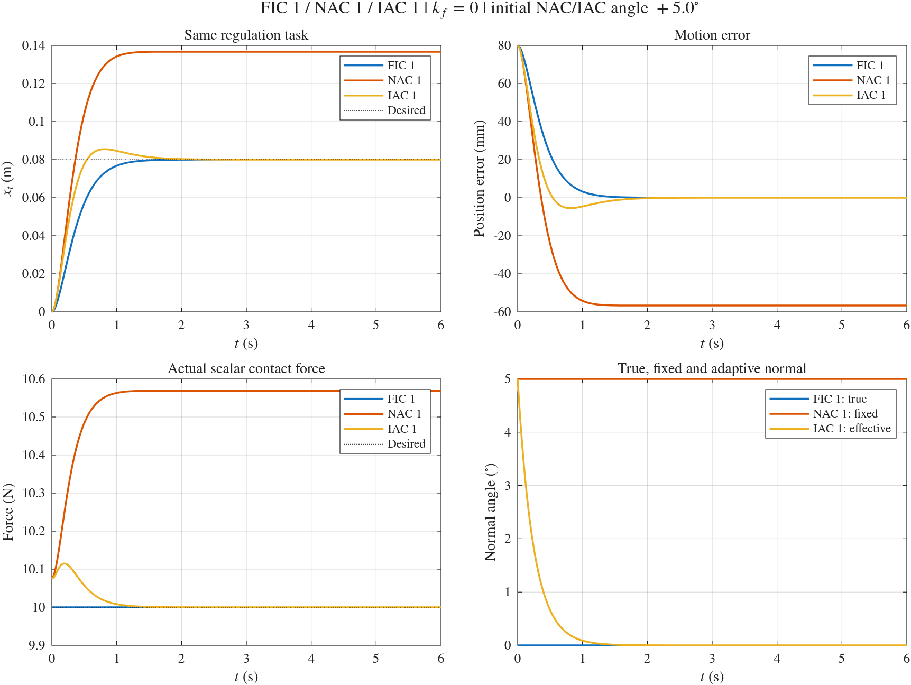
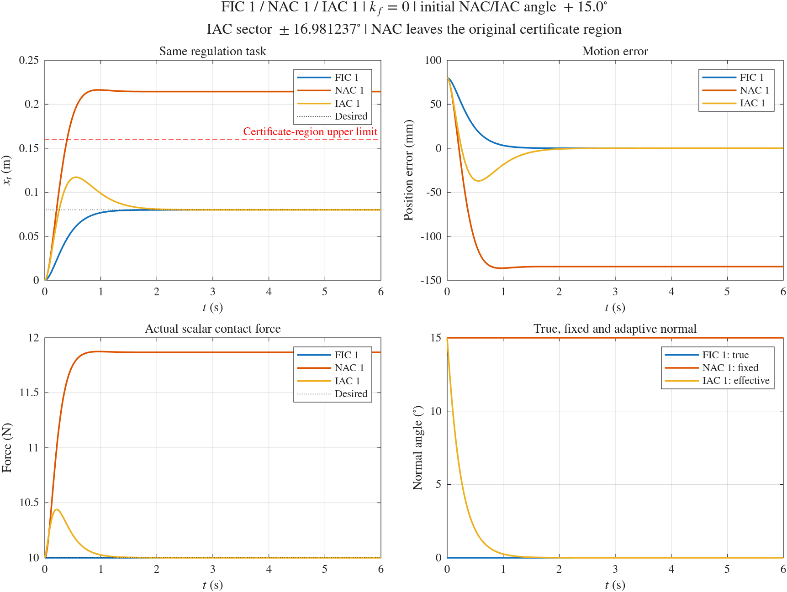
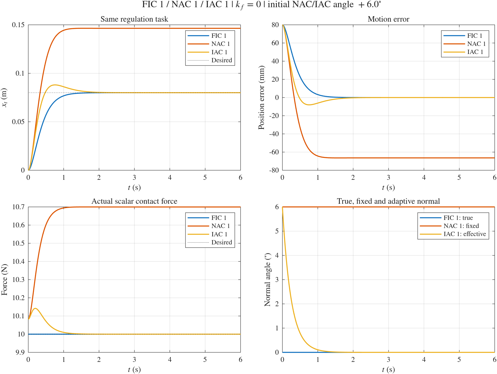

# FIC 1 / NAC 1 / IAC 1 三控制器对比仿真：普通与 max angle 工况

[English](../FIC1_NAC1_IAC1.md) | [简体中文](FIC1_NAC1_IAC1.md)

先打开 [hmfc.prj](../../../hmfc.prj)，或在工程根目录运行 [setup_project](../../../setup_project.m)，以加入 `numerical/`、`simscape/` 和 `numerical/shared/` 路径。

本文统一说明普通 +5° 工况和 max angle 的 +15° 工况。两组仿真入口和结果目录保持独立：

| 工况 | MATLAB 入口 | NAC/IAC 初始角度 | IAC 扇区半宽 |
| --- | --- | --- | --- |
| 普通工况 | `fic1_nac1_iac1_simulation` | +5° | 6° |
| max angle 工况 | `fic1_nac1_iac1_max_angle_simulation` | +15° | 上确界减去 `1e-6°`，约 16.981237° |

单独运行 NAC 1 的入口仍为 `numerical/nac1_simulation.m`，说明见 [NAC1.md](NAC1.md)。

## 普通工况的运行

```matlab
% 只运行 NAC 1：
nacResults = nac1_simulation;

% 重新运行三个控制器，生成三者的对比结果：
comparison = fic1_nac1_iac1_simulation;
```

三控制器入口也支持：

```matlab
comparison = fic1_nac1_iac1_simulation(struct('visible','off'));
comparison = fic1_nac1_iac1_simulation(struct('makePlots',false));
comparison = fic1_nac1_iac1_simulation(struct('outputDir',fullfile(pwd,'my_comparison')));
comparison = fic1_nac1_iac1_simulation(struct('initialAngleDeg',6));
```

`initialAngleDeg` 同时设置 NAC 1 的固定角度和 IAC 1 的初始有效角度，默认仍为 +5°。`sectorHalfWidthDeg` 默认 6，也可设为数值或 `'supremum'`；后者用上确界减去正数 `sectorMarginDeg`（默认 `1e-6°`）作为实际半宽。max angle 入口选择接近上确界的扇区和 +15° 初值，并另存结果，具体设置见下文。

`allowNacOutsideOperatingRegion` 默认 false。max angle 入口显式设为 true，仅允许 NAC 在原认证区域之外继续积分相同的物理模型，同时报告 `stayedInOperatingRegion=false` 和首次越界采样时间。IAC 和 FIC 仍严格保持原认证区域检查，区域范围本身没有改变。`results.allChecksPassed` 应与 `results.allStayedInOperatingRegion` 一起读取，前者通过不表示后者也为真。

## 运行与比较的内容

该入口依次调用三个独立实现，进行新的 ODE 积分，不读取以往保存的仿真结果。机器人模型由 `numerical/shared/` 维护，控制律和接触求解仍由各自文件维护，单控制器入口不依赖本对比入口。

对比选取三者相同的**主调节工况**：水平接触面、零初速、8 cm 目标位移、`kp=25`、`kv=10`、`fd=10 N`、`kf=0`、6 秒积分和 0.002 秒输出间隔。FIC 1 使用真实法向；NAC 1 始终固定为 +5°；IAC 1 从 +5° 开始自适应。运行后自动检查机器人参数、真实几何、初始状态、参考、增益、运行区域、输出时间及 NAC/IAC 初始估计的一致性。

各独立入口原有的补充验证也会执行，但三控制器对比图和汇总表只选取各自的主工况。不会将三个控制器的轨迹断言为相同；固定法向误差导致的 NAC 1 稳态偏差正是比较内容之一。

## 独立的输出目录

| 入口 | 默认结果目录 |
| --- | --- |
| `nac1_simulation` | `numerical/results/nac1/`，仅 NAC 1 |
| `fic1_nac1_iac1_simulation` | `numerical/results/fic1_nac1_iac1/`，三控制器联合运行与对比 |
| `fic1_nac1_iac1_max_angle_simulation` | `numerical/results/fic1_nac1_iac1_max_angle/`，+15° 的 max angle 对比 |

三控制器目录中包含：

- `comparison.png/.fig`：三者的位置、运动误差、接触力和法向角对比。
- `summary.csv`、`verification.txt`：三行主工况指标和一致性检查报告。
- `fic1_primary.csv`、`nac1_primary.csv`、`iac1_primary.csv`：统一字段的主工况采样数据。
- `fic1_nac1_iac1_results.mat`：完整返回值，包含 `results.fic1`、`results.nac1`、`results.iac1`、`results.runs` 和 `results.summary`。
- `fic1/`、`nac1/`、`iac1/`：本次分别执行三个独立仿真的原始输出。

该入口将子仿真输出显式指定到上述子目录，单独 NAC 1、IAC 1、FIC 1 的默认输出目录不会被覆盖。三控制器运行只显示和导出对比图，不额外打开单控制器的补充工况图。

## Max angle 工况：初始偏差 +15°

入口为 `numerical/fic1_nac1_iac1_max_angle_simulation.m`。本工况使用当前惯量界给出的扇区半宽上确界，并从内侧保留微小正裕量；NAC 1 固定为 +15°，IAC 1 从 +15° 开始自适应，FIC 1 使用真实的 0° 法向。

### 扇区和初始角度

当前惯量界对应 `chi_Lambda=1.484657397642`，文档的严格正接触力充分条件为：

$$
\rho_{\min}=\cos(2\Delta)-\chi_\Lambda\sin(2\Delta)>0,
\qquad
\Delta<\Delta_{\sup}=\frac12\arctan\frac1{\chi_\Lambda}.
$$

程序从 IAC 1 实际使用的模型和惯量界自动计算上确界，不硬编码计算结果：

| 项目 | 本工况 |
| --- | --- |
| 半宽上确界 `Delta_sup` | 约 16.9812382138°，不能取等号 |
| 内侧数值裕量 `sectorMarginDeg` | 0.000001° |
| 实际闭扇区半宽 `Delta` | 约 16.9812372138° |
| NAC/IAC 初始角度偏差 | +15° |

实际扇区为 `[-Delta,+Delta]`。直接取上确界会使统一正接触力下界为零，因此实现为 `Delta=Delta_sup-sectorMarginDeg`，保留 `rho_min>0`。接近上确界时，统一力下界和统一指数速率界会很小；它们是覆盖整个扇区的保守证书，不代表实际接触力接近零或实际收敛缓慢。

机器人、水平接触面、初始位置和速度、8 cm 参考位移、`kp=25`、`kv=10`、`fd=10 N`、`kf=0` 主工况、6 秒时长和 0.002 秒输出间隔沿用普通工况。默认的独立 IAC 1 和普通 +5° 三控制器对比仍使用原来的 ±6° 扇区。

### 运行

```matlab
% 接近扇区上确界，初始偏差 +15°：
wide = fic1_nac1_iac1_max_angle_simulation;

% 不显示图形窗口：
wide = fic1_nac1_iac1_max_angle_simulation(struct('visible','off'));

% 改变内侧裕量，仍必须为正且使实际半宽大于 15°：
wide = fic1_nac1_iac1_max_angle_simulation(struct('sectorMarginDeg',0.001));
```

入口支持 `makePlots`、`visible`、`outputDir`、`sectorMarginDeg`。原始 +6° 工况的输出已归档到 `numerical/results/fic1_nac1_iac1_max_angle_6deg/`。

### 原认证运行区与 NAC 1 越界

原认证区域仍为 `x_t` 在 (−0.04,0.16) m、`q2` 在 (70°,115°) 内。IAC 1 的惯量界和扇区上确界仍基于该区域，IAC 1 和 FIC 1 全程执行原有区域检查。

固定 +15° 法向会使 NAC 1 的偏置增大。该认证区域是分析假设，不是物理墙；本对比允许 NAC 1 在同一个可达、非奇异的精确机器人模型上继续运行，同时保留原区域的范围，逐点检查并标记越界。不会扩大 IAC 的认证区域，也不会将 NAC 区域条件未满足的情况报告成满足。

`results.nac1.runs(k).operatingRegionSatisfied`、`firstRegionExitTime`、主汇总表的 `stayedInOperatingRegion` 和顶层 `allStayedInOperatingRegion` 提供区域状态。`allChecksPassed` 表示启用的动力学、接触力、平衡点与输入一致性检查通过，应与区域状态一起读取。第一次越界时间由 0.002 秒采样点近似确定。

若希望遇到 NAC 越界就拒绝仿真，可使用通用入口并保持默认的 `allowNacOutsideOperatingRegion=false`；max angle 入口为完整展示大偏差下的 NAC 行为，显式设置该选项为 true。精确模型的可达性、非奇异性和正接触力检查仍然执行。

### 额外输出与实测结果

max angle 目录包含上文列出的对比图、汇总表、CSV、独立控制器子目录和完整 MAT 文件，另有 `initial_angle_analysis.txt` 记录扇区计算。`results.angleAnalysis` 同时保存上确界、实际半宽、数值裕量、15° 初值、正力下界和 NAC 区域状态。图标题和验证报告会标注本组 +15° 初始角度，避免与归档的 +6° 工况混淆。

MATLAB 实测：IAC 1 的 +15°、−15° 及其他补充工况均通过检查，仍留在原区域内。NAC 1 的主工况约在 0.400 s 首次被采样检测到越界；继续相同物理模型后，6 秒时位置误差为 −134.431306 mm、接触力为 11.867829 N。IAC 1 同时刻的位置误差约 −1.64e-10 m、接触力约 10 N。所有动力学和接触力一致性检查通过，NAC 的区域状态为 false。

<!-- simulation-figures -->
## 三控制器对比结果图

### 普通工况：+5°

**FIC 1 / NAC 1 / IAC 1 — +5°**



三者留在原认证区域；NAC 1 保留固定法向引起的稳态偏差，IAC 1 修正有效法向并收敛。

### Max angle 工况：+15°

**FIC 1 / NAC 1 / IAC 1 — +15°**



扇区半宽约 16.981237°。NAC 1 约在 0.400 s 越过原认证区域，图中的红虚线标明切向位移上限；越界后的曲线为同一物理模型的继续积分，不表示原区域保证仍有效。IAC 1 与 FIC 1 留在原区域内。

<details>
<summary>查看归档的 +6° 对比图</summary>

**归档 +6° 工况：原 ±6° 扇区，不是当前 +15° max angle 默认值**



</details>
