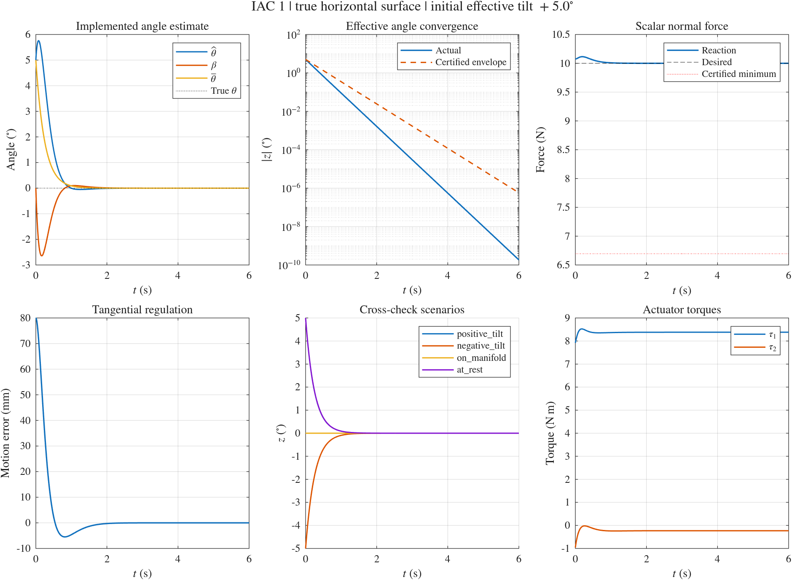

# IAC 1 独立 MATLAB ODE 仿真

[English](../IAC1.md) | [简体中文](IAC1.md)

统一参数、公共工况字段、CSV 列和旧接口迁移见[数值仿真统一接口](NUMERICAL_API.md)。

先打开 [hmfc.prj](../../../hmfc.prj)，或在工程根目录运行 [setup_project](../../../setup_project.m)，以加入 `numerical/`、`simscape/` 和 `numerical/shared/` 路径。

入口为 `numerical/iac1_simulation.m`，只依赖 MATLAB 基础功能。模型、控制器、估计器、接触反力求解和绘图均为文件内的局部函数，没有调用或修改任何 FIC 代码。

源文档的实际文件名为 `obsidian-vault/04-writing/tcst26/TCST26E3.md`，一级标题是 `TCST26`；本实现对应其中的 **IAC 1: Task-Space Control, Uncertain Surface Angle** 及两连杆机器人附录。

四个 FIC 的主调节工况已对齐本文件的默认工况：相同机器人参数、水平面、初始接触位置、零初速、8 cm 目标位移、运动增益、10 N 接触力、6 秒积分及 0.002 秒输出间隔。FIC 的 `regulation, kf=0` 提供已知真实法向的基准，IAC 1 的主工况保留 +5° 初始估计偏差。两套代码从 `numerical/shared/hmfc_parameters.m` 读取共用默认参数，机器人模型已抽到 `numerical/shared/`，控制器与接触求解仍分别实现；FIC 的跟踪与其他力增益，以及 IAC 1 的估计器交叉验证，仍作为各自的补充测试。

## 运行

本文件的 `iac1_simulation` 仅运行 IAC 1。如需重新运行并比较 FIC 1、NAC 1 和 IAC 1，使用 `comparison = fic1_nac1_iac1_simulation;`，结果另存至 `numerical/results/fic1_nac1_iac1/`；详见 [三控制器对比说明](FIC1_NAC1_IAC1.md)。

在本目录执行：

```matlab
results = iac1_simulation;
```

无界面运行并保存图像：

```matlab
results = iac1_simulation(struct('visible','off'));
```

只计算和校验：

```matlab
results = iac1_simulation(struct('makePlots',false,'saveResults',false));
```

可以覆盖 `initialAngleDeg`、`initialVelocity`、`duration`、`outputDir`、`makePlots`、`saveResults`、`visible`、`sectorHalfWidthDeg` 和 `sectorMarginDeg`。初始角度指定的是有效估计 `bar_theta(0)`，以度为单位，必须位于所选扇区；默认半宽仍为 6°。`sectorHalfWidthDeg` 可设为数值半宽，或字符串 `'supremum'`，后者根据当前惯量界计算严格上确界后减去正裕量 `sectorMarginDeg`（默认 `1e-6°`）。控制方程内部全部使用弧度。`duration` 至少为 6 秒，以便执行末端收敛检查。增大初始速度等操作仍须满足机器人运行区域，越界会停止并报错。

默认闭扇区允许的最大初始有效角度偏差为 6°。max angle 入口 `fic1_nac1_iac1_max_angle_simulation` 则使用接近半宽上确界 16.981238° 的扇区和 +15° 初值，单独保存三控制器对比，详见 [普通与 max angle 工况说明](FIC1_NAC1_IAC1.md)。

## 工况与模型

- 真实接触面为水平直线 `y = 0.4 m`，环境位于其下方，真实法向 `n = [0;1]`，真实角度为 0°。
- 初始接触位置 `p0 = [0.6;0.4] m`；初始法向速度为零，接触已建立。
- 主工况初始有效估计为 +5°，即 `bar_n(0) = [-sin(5°);cos(5°)]`；初始速度为零。
- 定点调节目标为 `p_d = [0.68;0.4] m`，期望法向力为 10 N。
- 已知模型为竖直平面两转动关节机器人：杆长 0.6、0.5 m，质量 2、1.5 kg，质心位于杆中点，转动惯量取均匀细杆值；显式保留重力、科氏项和构型相关的笛卡尔惯量。
- `k_p = 25`、`k_v = 10`、`gamma = 0.4`，名义角度中心为 0°，先验扇区为 ±6°。

同时运行三项交叉验证：−5° 初始偏差；有效初始角度为零但初始切向速度为 0.02 m/s 的流形不变性；目标即初始位置、初始速度为零但有 +5° 偏差的调节工况。最后一项没有外加运动激励，估计误差仍会引起短暂切向运动。

参考点落在真实接触线上是文档的题设假定。本仿真事先给定这样的参考点，控制器没有使用真实法向投影参考或误差信号。

## 方程实现

ODE 状态仅为 `[x_t; dx_t; hat_theta]`。真实刚性接触通过最小坐标 `p = p0 + T*x_t` 实现；利用固定肘形的逆运动学恢复 `q`，利用 `J\dp` 恢复 `dq`。没有罚弹簧、接触阻尼或法向约束稳定化。

控制器实现：

```text
m_p       = Lambda * dp
beta      = -gamma * T_c' * m_p
bar_theta = hat_theta + beta
bar_n     = R(bar_theta) * n0
u_p       = k_p * (p_d - p) - k_v * dp
F         = eta + Lambda * u_p - bar_n * f_d
tau       = J' * F
g_p       = F - eta + dLambda * dp
dhat_theta = gamma * T_c' * (g_p + bar_n * f)
```

`dLambda` 由已知模型解析求导计算，代码还用独立中心差分检查它。初始内部估计按 `hat_theta(0) = bar_theta(0) + gamma*T_c'*Lambda(0)*dp(0)` 设置，包含非零初始动量的情形。

物理模型通过以下线性约束方程求实际加速度及标量接触反力，然后将反力作为力传感器输入送给估计器：

```text
[M      -J'*n] [ddq] = [tau-C*dq-G   ]
[n'*J       0] [f     ]   [-n'*dJ*dq]

ddp = J*ddq + dJ*dq
```

控制器和估计器的参数接口没有真实 `n`、真实角度、参数误差 `z` 或实测加速度；真实几何仅用于物理模型、离线认证和验证。没有将文档推导出的 `dz` 作为 ODE，也没有直接用理论反力公式生成传感器读数。

## 验证与输出

在 `q2` 属于 [70°,115°] 的区域，由两连杆惯量的迹和行列式给出解析的统一惯量上下界，据此计算文档中的 `chi_Lambda`、`rho_min`、接触力下界及角度指数包络。这些界不依赖轨迹采样拟合。切向坐标另限制在 [−0.04,0.16] m；代码检查轨迹，并用 ODE 事件监视运行区域、估计扇区及正接触反力。

每个工况自动检查：

- 笛卡尔和关节动力学、动量方程的残差。
- 由实际控制器得到的 `dz` 与理论误差方程的一致性，以及积分后有效角度的中心差分校验。
- 反力关系 `f/f_d = cos(z) + r_Lambda*sin(z)`、切向误差动力学。
- 接触力严格为正且不小于认证下界；角度不离开扇区且满足指数包络。
- 法向间隙、法向速度和机器人惯量范围。
- 末端角度误差小于 `1e-6 rad`，切向误差小于 `1e-6 m`，速度小于 `1e-6 m/s`，力误差小于 `1e-5 N`。
- 零有效初始误差工况的流形不变性。

默认结果保存在 `numerical/results/iac1/`：完整 `iac1_results.mat`、四个工况的 CSV、`summary.csv`、包含误差与残差的 `verification.txt`，以及 `iac1_summary.png`、可编辑的 `iac1_summary.fig`。函数返回的 `results.runs` 包含全部信号与检查结果。

这些是文档理想条件下的数值验证：精确模型、精确标量力测量、理想执行器和已建立的无摩擦刚性接触。仿真不包含建立接触、碰撞、脱离后的运动模式或测量噪声；负反力不会被截成零来掩盖接触失效。

<!-- simulation-figures -->
## 仿真结果图

**独立 IAC 1：+5° 主工况及反向偏角、流形不变性、原地调节验证**


